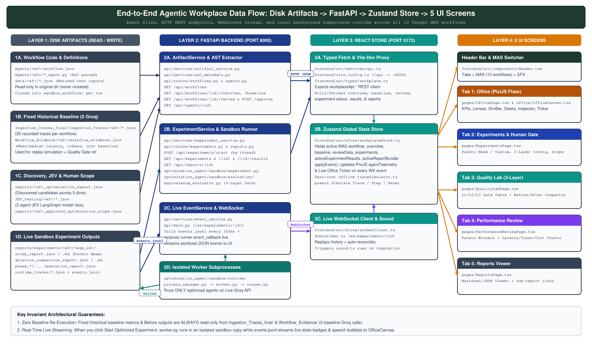
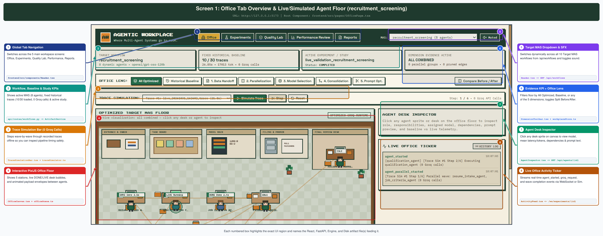
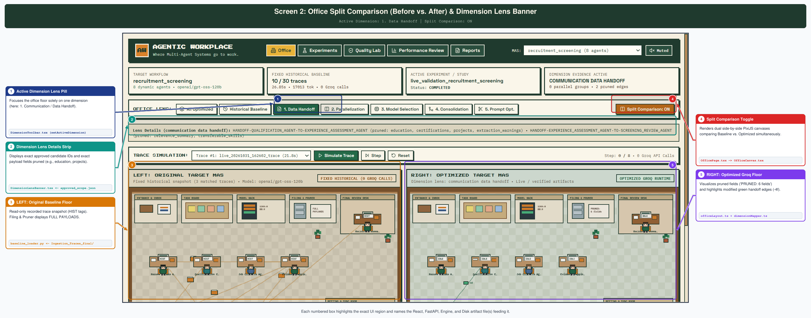
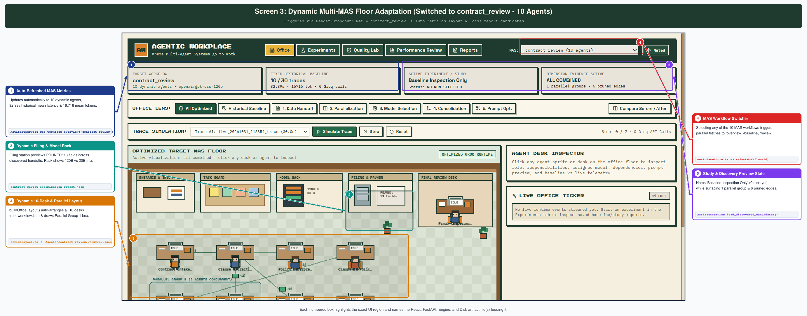
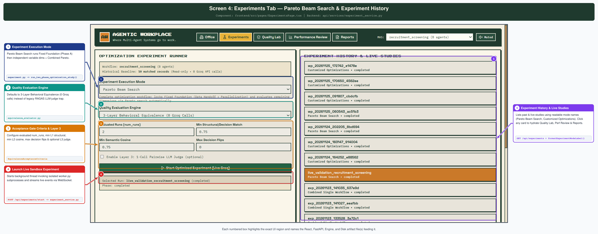
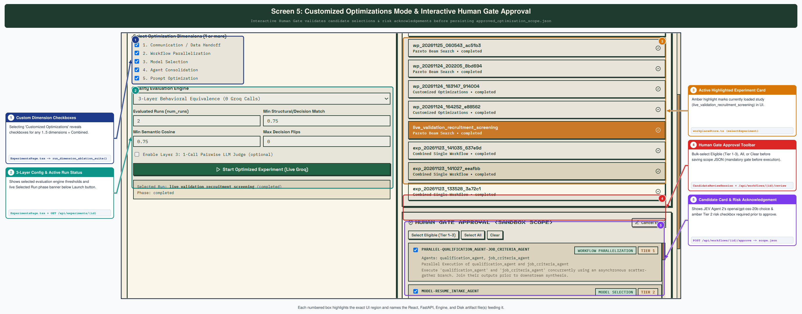
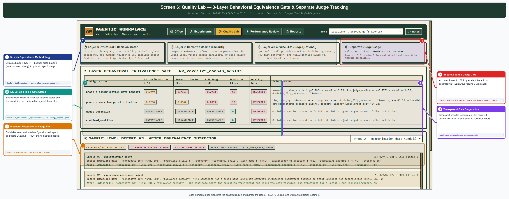
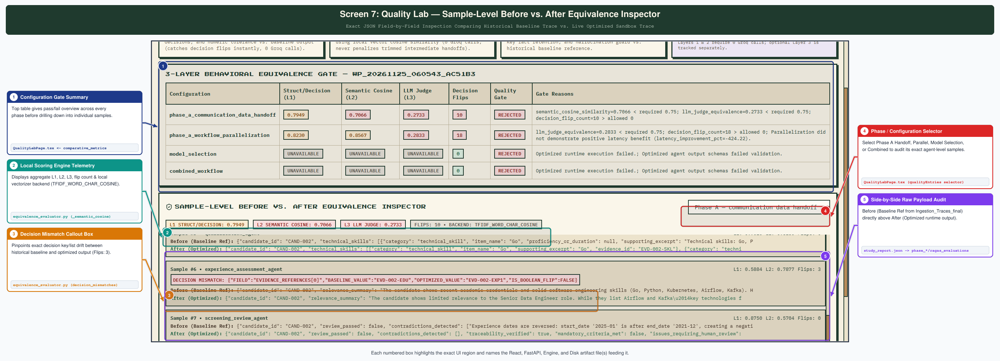
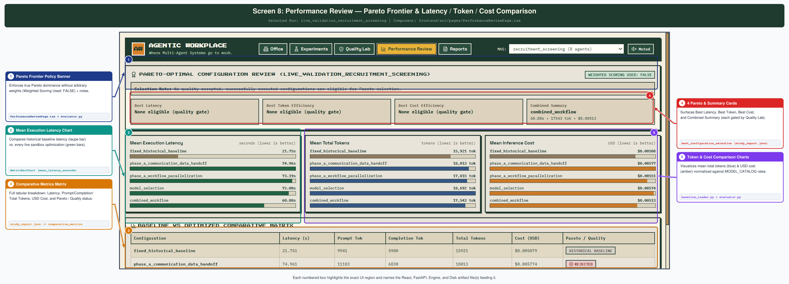
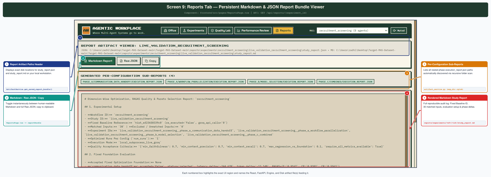

# Agentic Workplace — Visual UI Walkthrough, Behind-the-Scenes Data Flow, and Complete 10-MAS Mapping

**System Under Documentation:** Agentic Workplace (`http://127.0.0.1:5173` React/Vite Frontend + `http://127.0.0.1:8000` FastAPI Backend + Isolated Python Sandbox Execution Engine)  
**Target Corpus:** 10 Multi-Agent System (MAS) Workflows (77 Total Specialized Agents, 300 Recorded Baseline Traces)  
**Companion Annotated Visuals:** [`ui_walkthrough_screenshots/`](ui_walkthrough_screenshots/)

---

## Executive Summary in Plain English

Think of **Agentic Workplace** as a visual control room built on top of the Multi-Agent System (MAS) optimizer:

1. **You never modify your original MAS source code directly.** When you switch between any of the 10 workflows, the UI reads read-only Python source metadata (`Agents/<workflow>/`), previously recorded baseline runs (`Ingestion_Traces_final/` + `Workflow_Evidence/`), previously discovered optimization opportunities (`reports/<workflow>_optimization_report.json`), and human-approved optimization scopes (`reports/<workflow>_approved_optimization_scope.json`).
2. **You never burn Groq API credits just to inspect or replay baseline runs.** Both the historical KPI cards and the `Simulate Trace / Step / Reset` bar replay saved JSON traces (`0 Groq API Calls`) through `traceSimulator.ts`.
3. **When you launch a live optimization study**, the backend clones the target MAS into a temporary sandbox folder, launches isolated OS worker subprocesses (`worker.py` -> `runner.py`) that execute **only** the optimized configurations against live Groq APIs, writes real-time JSON events to `events.jsonl` and WebSockets (`/ws/experiments/{id}`), evaluates quality via a **3-Layer Behavioral Equivalence Gate**, checks **Pareto dominance** (without arbitrary weighted scoring), and persists permanent Markdown/JSON audit reports (`reports/experiments/<workflow>/<exp_id>/`) that immediately hydrate the **Quality Lab**, **Performance Review**, and **Reports** tabs.

---

## Part 1: End-to-End UI & Backend Data Architecture

Before looking at individual screens, the diagram below traces how data moves from disk files through FastAPI into the React global store (`workplaceStore.ts`) and onto each of the 5 workspace tabs.

*Figure 0: Four-layer data flow connecting Disk Artifacts (Layer 1), FastAPI & Sandbox Workers (Layer 2), Zustand Store & WebSocket Client (Layer 3), and the 5 UI Screens (Layer 4).*

### Quick Reference Table: Where Every UI Widget Gets Its Data

| UI Surface / Widget | Frontend Component(s) | HTTP / WebSocket Endpoint | Backend Controller & Service | Exact Disk File(s) Read or Written |
| :--- | :--- | :--- | :--- | :--- |
| **Top Nav & Workflow Switcher** | `frontend/src/components/Header.tsx` | `GET /api/workflows` | `api/routes/workflows.py` -> `ArtifactService.list_workflows()` | Scans `Target-MAS-Dataset-main/Agents/*/workflow.json` & `Workflow_Evidence/*/workflow_evidence.json` |
| **KPI Cards & Office Agents** | `frontend/src/pages/OfficePage.tsx`, `src/office/officeLayout.ts` | `GET /api/workflows/{id}/overview`, `/baseline` | `ArtifactService.get_workflow_overview()`, `get_workflow_baseline()` | `Agents/<wf>/workflow.json`, AST-parsed `*_agent.py`, `Workflow_Evidence/<wf>/workflow_evidence.json`, `Ingestion_Traces_final/Ingestion_Traces/<wf>/*.json` |
| **Office Lens & Before/After Filter** | `DimensionToolbar.tsx`, `DimensionLensBanner.tsx`, `src/office/dimensionMapper.ts` | Populated from `/overview` (`discovered_candidates`, `approved_scope`) | `ArtifactService.load_discovered_candidates()`, `load_approved_scope()` | `reports/<wf>_optimization_report.json` (discovered preview) & `reports/<wf>_approved_optimization_scope.json` (approved IDs) |
| **Trace Simulation Bar (0 Groq Calls)** | `frontend/src/components/TraceSimulationBar.tsx`, `src/store/traceSimulator.ts` | Uses `/baseline` trace payload loaded at workflow selection | `ArtifactService.get_workflow_baseline(limit=10)` | Reads first 10 of 30 JSON files in `Ingestion_Traces_final/Ingestion_Traces/<wf>/live_*.json` |
| **Agent Desk Inspector** | `frontend/src/components/AgentInspector.tsx` | `GET /api/agents/{id}?workflow_id=<wf>` | `api/routes/agents.py` -> `ArtifactService.get_agent_details()` | `Agents/<wf>/*_agent.py` (prompt/AST) + `Workflow_Evidence/<wf>/workflow_evidence.json` + latest trace output preview |
| **Experiments Launch Form** | `frontend/src/pages/ExperimentsPage.tsx` | `POST /api/experiments/start`, `GET /api/experiments` | `api/routes/experiments.py` -> `ExperimentService.start_experiment()` | Launches `optimization_agent/sandbox/experiment.py` -> writes `reports/experiments/<wf>/<exp_id>/events.jsonl` & reports |
| **Human Gate Approval Panel** | `ExperimentsPage.tsx` (Right-bottom card) | `GET /api/workflows/{id}/review`, `POST /api/workflows/{id}/approve` | `ArtifactService.get_review_session()`, `approve_workflow_scope()` | Reads `reports/<wf>_optimization_report.json` + `JEV_testing/<wf>/`; writes `reports/<wf>_approved_optimization_scope.json` |
| **Live Desk Bubbles & Ticker** | `OfficeCanvas.tsx`, `ActivityFeed.tsx`, `socketClient.ts`, `sound.ts` | `WS /ws/experiments/{id}` | `api/main.py` websocket endpoint + `EventService` (`0.35s` tail) | Reads live callbacks & tails `reports/experiments/<wf>/<exp_id>/events.jsonl` |
| **Quality Lab (3-Layer Gate)** | `frontend/src/pages/QualityLabPage.tsx` | `GET /api/experiments/{id}/results` | `ExperimentService.get_experiment_results()` | `study_report.json` or `ablation_comparison_report.json` (`comparative_metrics`, `phase_*/ragas_evaluations`) |
| **Performance Review & Pareto** | `frontend/src/pages/PerformanceReviewPage.tsx`, `MetricBarChart.tsx` | `GET /api/experiments/{id}/results` | `ExperimentService._format_results_from_report()` | Same `study_report.json` / `ablation_comparison_report.json` (`best_configuration_selection`, `pareto_frontier`) |
| **Reports Viewer** | `frontend/src/pages/ReportsPage.tsx` | `GET /api/reports/{experiment_id}` | `api/routes/reports.py` -> `ArtifactService.get_saved_report_bundle()` | `study_report.md` + `.json`, `ablation_comparison_report.md` + `.json`, plus `rglob("*_execution_report.json")` |

*(Note: All frontend API requests are routed via Vite's dev proxy configured in `Target-MAS-Dataset-main/frontend/vite.config.ts`, forwarding `/api/*` to `http://127.0.0.1:8000` and `/ws/*` to `ws://127.0.0.1:8000`.)*

---

## Part 2: Screen-by-Screen Annotated Walkthrough (All 9 Views)

Every screenshot below was captured directly from the live running Agentic Workplace UI (`http://127.0.0.1:5173`) and annotated with numbered directional arrows pointing to each functional area and its underlying source files.

---

### Screen 1: Office Tab Overview & Simulated / Live Floor (`recruitment_screening`)

*Figure 1: Default Office view showing `recruitment_screening` mid-simulation (`Step` clicked twice) with live speech bubbles (`DONE Done 2.5s`, `LIVE Running`) and real-time ticker updates.*

**What each numbered area does in simple words:**

1. **Global Tab Navigation (`frontend/src/components/Header.tsx`):** Lets you jump between the 5 screens (`Office`, `Experiments`, `Quality Lab`, `Performance Review`, `Reports`). Switching tabs never loses your selected workflow or loaded experiment because everything lives in the central Zustand store (`frontend/src/store/workplaceStore.ts`).
2. **Workflow, Baseline & Study KPIs (`api/routes/workflows.py` -> `ArtifactService`):**
   - **Workflow Card:** Displays the active MAS name (`recruitment_screening`), agent count (`8 agents`), and whether an optimization scope file has already been human-approved (`Approved: 4`).
   - **Historical Baseline Card:** Always read-only (`0 Groq calls`), showing average (`44.80s`) and median (`30.60s`) latency, average tokens (`16,910 tok`), and trace load status (`10 / 30 traces`).
   - **Active Study Card:** Shows whichever experiment you currently have selected (`wp_20261125_060543_ac51b3` -> `completed` / `2-Phase Study`), or `Idle` if you haven't selected/started one yet.
3. **Trace Simulation Bar — 0 Groq Calls (`TraceSimulationBar.tsx` + `traceSimulator.ts`):** Because live Groq runs take seconds and cost API quota, this bar lets you select any saved historical trace (for instance `live_20261031_162602_trace01.json`) and click **`Simulate Trace`** (auto-play), **`Step`** (advance one execution wave at a time), or **`Reset`**. In the screenshot above, clicking **`Step`** twice ran Wave 1 (`resume_intake_agent` -> `DONE Done 2.5s`), Wave 2 (`qualification_agent` + `job_criteria_agent` running in parallel -> `LIVE Running`), and Wave 3 (`DONE Done 2.4s`). Zero external API calls are made.
4. **Interactive PixiJS Office Floor (`OfficeCanvas.tsx` + `officeScene.ts`):** Draws a warm 2D studio office floor with 5 permanent functional stations:
   - **Reception / Intake (`INTAKE`)** at left where traces enter.
   - **Filing & Pruner (`PRUNED`)** showing discovered or approved pruned payload field counts.
   - **Model Rack (`120B -> 20B / 8B` vs `70B/8B`)** showing model selection swaps.
   - **Prompt Wall (`PROMPT OPT`)** displaying optimized system prompt badges.
   - **Evaluator Desk (`3-LAYER + PARETO`)** at top-right representing quality and Pareto checks.
   - Plus **one desk per agent** arranged cleanly into parallel wave containers (e.g., `Parallel Group 1`), live speech bubbles (`HIST`, `LIVE`, `DONE`), and animated envelope packets moving across dependency wires (`->`).
5. **Target MAS Dropdown & SFX Toggle (`Header.tsx -> GET /api/workflows`):** Switching the `MAS:` dropdown immediately reconfigures the entire workspace for any of the 10 Target MAS workflows. The `SFX On / Muted` toggle controls lightweight WebAudio cues (`frontend/src/store/sound.ts`) when waves finish or experiments complete.
6. **Evidence KPI & Office Lens Toolbar (`DimensionToolbar.tsx` + `workplaceStore.ts`):** Filter the office desks by **`All Optimized`**, **`Historical Baseline`**, or any individual dimension (**`1. Data Handoff`**, **`2. Consolidation`**, **`3. Model Selection`**, **`4. Parallelization`**, **`5. Prompt Opt.`**). The **`Compare Before / After`** toggle splits the floor into two side-by-side rooms.
7. **Agent Desk Inspector (`AgentInspector.tsx -> GET /api/agents/{id}`):** Clicking any desk sprite on the floor populates this panel with that agent's current LLM model, mean latency (`s`), mean tokens, `Hybrid Rules + LLM` vs `Pure LLM Agent` classification (extracted via Python `ast` in `api/services/ast_metadata.py`), upstream/downstream dependencies, and source prompt snippet.
8. **Live Office Activity Ticker (`ActivityFeed.tsx <- /ws/experiments/{id}`):** Shows a chronological stream of events from either offline `TraceSimulationBar` stepping (shown here: `Trace Sim Step -> Agent Started/Completed`) or a real live sandbox run (`agent_started`, `groq_request_completed`, `candidate_completed`, `study_completed`).

---

### Screen 2: Office Split Comparison (`Before` vs `After`) & Dimension Lens Banner

*Figure 2: Office floor split side-by-side under the `1. Data Handoff` lens, exposing exact approved handoff pruning differences between the original recorded baseline (left) and optimized configuration (right).*

**What each numbered area does in simple words:**

1. **Active Dimension Lens Pill (`DimensionToolbar.tsx`):** Highlighting **`1. Data Handoff`** isolates the visual highlights on the floor so only communication/handoff changes glow green; unrelated optimizations (such as parallelization or prompt tuning) stay calm so you can study one optimization mechanism cleanly.
2. **Dimension Lens Details Strip (`DimensionLensBanner.tsx <- approved_scope.json`):** Automatically displays what the selected lens actually changes. Here it shows the exact approved handoff IDs (`HANDOFF-QUALIFICATION_AGENT-TO-EXPERIENCE_ASSESSMENT_AGENT` and `HANDOFF-EXPERIENCE_ASSESSMENT_AGENT-TO-SCREENING_REVIEW_AGENT`) and the exact JSON fields removed (`education, projects, contact_info, certifications, summary, skills`), plus the latest Quality Lab gate result if a study is selected.
3. **LEFT: Original Baseline Floor (`baseline_loader.py <- Ingestion_Traces_final/`):** Displays the untouched historical MAS pipeline. Notice the `HIST` speech bubbles and **`FULL PAYLOADS`** label on the Filing & Pruner cabinet—no fields have been stripped and execution remains sequential.
4. **Split Comparison Toggle (`OfficePage.tsx -> OfficeCanvas.tsx`):** Turning **`Compare Before / After`** ON mounts two synchronized `OfficeCanvas` instances side by side so stakeholders can visually audit topology and payload reductions at a glance.
5. **RIGHT: Optimized Groq Floor (`officeLayout.ts + dimensionMapper.ts`):** Highlights the modified green handoff links (**`-4f`** meaning 4 redundant fields stripped from the `qualification_agent -> experience_assessment_agent` edge) and updates the Filing & Pruner cabinet to **`PRUNED: 6 fields`**.

---

### Screen 3: Dynamic Multi-MAS Floor Adaptation (`contract_review` — 10 Agents)

*Figure 3: Switching the header MAS dropdown to `contract_review` automatically rebuilds the PixiJS floor for all 10 agents, pulls baseline evidence, and surfaces unapproved discovery previews.*

**What each numbered area does in simple words:**

1. **Auto-Refreshed MAS Metrics (`ArtifactService.get_workflow_overview('contract_review')`):** Within milliseconds of picking `contract_review`, the KPI cards swap to `10 dynamic agents`, `Approved: 0` (meaning no human scope approval saved yet), `32.39s` baseline mean latency (Wait — see the note in Part 4: `ArtifactService` computes `32.39s` from the loaded 10 traces while `Workflow_Evidence` reports the full 30-trace mean of `57.13s`!), `16,716 tok`, and `10 / 30 traces`.
2. **Dynamic Filing & Model Rack (`contract_review_optimization_report.json`):** Even before you run a live study, if an offline discovery report exists in `reports/`, the office Filing station previews **`PRUNED: 13 fields`** across discovered data handoffs and the Model Rack visualizes discovered 120B vs 20B candidates (`Discovered Preview — Not Yet Approved`).
3. **Dynamic 10-Desk & Parallel Layout (`officeLayout.ts <- Agents/contract_review/workflow.json`):** Desk coordinates are **never hardcoded per workflow**. `buildOfficeLayout()` reads `workflow.json` (`stages` & `parallel_groups`) and automatically arranges all 10 agent sprites into rows, draws `Parallel Group 1` around parallel-safe clause analysis agents, and renders the full `10`-node directed dependency graph.
4. **MAS Workflow Switcher (`workplaceStore.ts -> selectWorkflow(id)`):** Changing this dropdown cancels any stale simulation, clears unrelated experiment panels, and issues parallel fetches to `/overview`, `/baseline`, `/review`, `/experiments?workflow_id=...`, and `/agents/...`.
5. **Study & Discovery Preview State (`ArtifactService.load_discovered_candidates()`):** Tells you honestly `Baseline Inspection Only` (`No active live experiment`) while summarizing how many optimization opportunities discovery found (`1 parallel groups • 6 pruned edges`) waiting in the **Experiments** tab's Human Gate for your approval.

---

### Screen 4: Experiments Tab — Pareto Beam Search & History

*Figure 4: Experiments launcher configured in `Pareto Beam Search` mode with `3-Layer Behavioral Equivalence (0 Groq Calls)` enabled and full saved study history listed on the right.*

**What each numbered area does in simple words:**

1. **Experiment Execution Mode (`experiment.py -> run_two_phase_optimization_study()`):**
   - **`Pareto Beam Search` (`two_phase_study`):** Our primary two-phase search algorithm. It fixes Phase A foundation optimizations (Data Handoff + Consolidation + Parallelization) first, then tests variable optimization dimensions (Model Selection & Prompt Optimization) plus Combined Pareto frontiers cleanly without combinatorial explosion.
   - **`Customized Optimizations` (`dimension_ablation_suite`):** Lets you pick exact individual dimensions or subsets (see Screen 5).
2. **Quality Evaluation Engine (`equivalence_evaluator.py`):** Defaults to **`3-Layer Behavioral Equivalence (0 Groq Calls)`**—replacing the legacy RAGAS LLM-judge workflow which falsely penalized valid concise outputs via Context Recall and consumed ~66 extra Groq calls (`181.8k` tokens, `$0.314`) per study. You can still toggle back to `Legacy RAGAS` in the dropdown for benchmarking.
3. **Acceptance Gate Criteria & Optional Layer 3 (`EquivalenceAcceptanceCriteria`):** Lets you tune:
   - **Test inputs (`num_runs`):** Up to `30` matched test cases from `data/<workflow>/` corresponding 1-for-1 to the 30 historical baseline traces.
   - **Layer 1 Structural & Decision Score (`0.75` default):** Key F1 + JSON schema adherence + decision agreement.
   - **Layer 2 Semantic Cosine Similarity (`0.75` default):** Fast, free local TF-IDF word/char n-gram cosine similarity (`~45 ms`).
   - **Max Allowed Decision Flips (`0` default):** Strict guard ensuring boolean/verdict choices (like `SHORTLIST` vs `REJECT`) do not flip.
   - **Optional Layer 3 Tie-Breaker Judge:** Off by default (`0 Groq Calls`); enables a lightweight secondary LLM semantic judge strictly for borderline samples.
4. **Launch Live Sandbox Experiment (`POST /api/experiments/start -> experiment_service.py`):** Starts the isolated background execution thread and immediately streams progress back to the UI and the **Office** tab.
5. **Experiment History & Live Studies (`GET /api/experiments + formatExperimentModeLabel()`):** Lists every completed or currently running study for the active workflow using the updated human-readable mode names (`Pareto Beam Search` for `two_phase_study`, `Customized Optimizations` for `dimension_ablation_suite`). Clicking any card populates **Quality Lab**, **Performance Review**, and **Reports** instantly.

---

### Screen 5: Customized Optimizations Mode & Interactive Human Gate Approval

*Figure 5: Experiments page scrolled to show `Customized Optimizations` dimension checkboxes (left) and the `Human Gate Approval (Sandbox Scope)` panel where Tier 2 risk acknowledgement is required before saving.*

**What each numbered area does in simple words:**

1. **Custom Dimension Checkboxes (`ExperimentsPage.tsx -> run_dimension_ablation_suite()`):** Choosing `Customized Optimizations` exposes explicit toggles for **`Data Handoff`**, **`Parallelization`**, **`Model Selection`**, **`Prompt Optimization`**, **`Consolidation`**, and **`Combined All`**. Useful for isolated ablation studies or testing a single dimension change quickly.
2. **3-Layer Config & Active Run Status (`ExperimentsPage.tsx + GET /api/experiments/{id}`):** Displays the currently selected study badge (`live_validation_recruitment_screening • COMPLETED`) right under the Launch button, confirming which run is currently feeding **Quality Lab**, **Performance Review**, and **Reports**.
3. **Active Highlighted Experiment Card (`workplaceStore.ts (selectExperiment)`):** An amber border/fill (`live_validation_recruitment_screening`) highlights which historical or live experiment is currently loaded into memory.
4. **Human Gate Approval Toolbar (`CandidateReviewSession + /api/workflows/{id}/review`):** Before any experiment can apply optimizations in the sandbox, a human reviews discovery candidates and saves `reports/<workflow>_approved_optimization_scope.json`. Quick buttons let you **`Select Eligible (Tier 1-3)`**, **`Select All`**, or **`Clear`**.
5. **Candidate Card & Risk Acknowledgement (`POST /api/workflows/{id}/approve -> scope.json`):** Each discovered candidate displays its **`TIER 1 / TIER 2 / TIER 3`** safety tier, target agent(s), and exact changes (here: `MODEL-RESUME_INTAKE_AGENT` swapping `openai/gpt-oss-120b -> openai/gpt-oss-20b` chosen by the **2-agent JEV LangGraph workflow** in `JEV_testing/`). Higher-risk candidates like Tier 2 require checking **`Acknowledge Risk`** before the **`Save Scope`** button writes the JSON file to disk.

---

### Screen 6: Quality Lab — 3-Layer Behavioral Equivalence Gate & Judge Usage

*Figure 6: Quality Lab displaying Layer 1–3 definitions, Separate Judge Usage overhead (`Calls: 6 • Tokens: 10056 • Cost: $0.0028`), and the full configuration equivalence gate table (`wp_20261125_060543_ac51b3`).*

**What each numbered area does in simple words:**

1. **3-Layer Equivalence Methodology Cards (`QualityLabPage.tsx + equivalence_evaluator.py`):** Summarizes the three defensive quality layers in plain terms:
   - **Layer 1 (Structural & Decision):** Verifies JSON keys, types, and exact final verdicts match historical outputs (`0 Groq calls`).
   - **Layer 2 (Local Semantic Similarity):** Checks prose/reasoning meaning locally with TF-IDF n-grams (`0 Groq calls`).
   - **Layer 3 (Optional Borderline Judge):** Runs **only** on borderline or disputed items when explicitly enabled.
2. **L1, L2, L3, Flips & Gate Status Columns (`evaluate_behavioral_equivalence() -> study_report.json`):** Every tested optimization configuration gets a dedicated row showing exact **`L1 (Struct/Dec)`**, **`L2 (Cosine)`**, **`L3 (Judge)`** (or `SKIP` when Layer 1+2 already decide cleanly), **`Flips`** (total boolean/verdict mismatches), and overall **`Gate Status`** (**`PASS`** or **`FAIL`**).
3. **Inspector Dropdown & Engine Badge Bar (`QualityLabPage.tsx (selectedKey state)`):** Lets you select any configuration (`phase_a_handoff`, `phase_b_parallelization`, etc.) to drill into its agent-level inputs and outputs right below the summary table.
4. **Separate Judge Usage Card (`ragas_evaluation_model_usage -> study_report.json`):** Strictly separates evaluator overhead from MAS runtime cost. Even when Layer 3 tie-breaking runs (`wp_20261125_060543_ac51b3` used just `6 calls / 10,056 tokens / $0.0028`), standard Layer 1+2 default mode reports `0 calls / 0 tokens / $0.0000`.
5. **Transparent Gate Diagnostics (`evaluate_equivalence_acceptance()`):** Never hides *why* a configuration failed. Every `FAIL` row explains its exact reason in plain text (for example: `Decision Flips = 5 > max 0`, `L2 Semantic Cosine = 0.713 < 0.75`, or `Runtime validation error`).

---

### Screen 7: Quality Lab — Sample-Level Before vs. After Equivalence Inspector

*Figure 7: Quality Lab scrolled to the Sample-Level Inspector (`Sample #6 • experience_assessment_agent`), highlighting exact `DECISION MISMATCH` diagnostics between Baseline Before and Optimized After JSON payloads.*

**What each numbered area does in simple words:**

1. **Configuration Gate Summary (`QualityLabPage.tsx <- comparative_metrics`):** Keeps the top summary table reachable above the inspector so you can spot which phase failed or passed before examining its raw payloads.
2. **Local Scoring Engine Telemetry (`equivalence_evaluator.py (_semantic_cosine)`):** Displays the per-configuration score breakdown (`L1: 0.903 | L2: 0.713 | L3: 0.567 | Flips: 5`) along with the local similarity backend stamp (**`TFIDF_WORD_CHAR_COSINE`**), proving similarity was measured locally without an LLM call.
3. **Decision Mismatch Callout Box (`equivalence_evaluator.py (decision_mismatches)`):** Immediately flags any sample whose decision field changed between historical baseline and optimized execution—for instance **`DECISION MISMATCH`** on `Sample #6 • experience_assessment_agent` where `L1=0.692` and `L2=0.646`.
4. **Phase / Configuration Selector (`QualityLabPage.tsx (qualityEntries selector)`):** Switches the sample audit feed between every executed configuration (such as `Phase A Handoff`, `Parallelization`, `Model Selection`, and `Combined All`).
5. **Side-by-Side Raw Payload Audit (`study_report.json -> phase_*/ragas_evaluations`):** Renders the historical **Before (Baseline Reference)** JSON payload directly next to the **After (Optimized Sandbox)** JSON output for each agent and test sample, so you can read the actual LLM text and see whether compression preserved meaning or caused drift.

---

### Screen 8: Performance Review — Pareto Frontier & Latency / Token / Cost Comparison

*Figure 8: Performance Review tab (`live_validation_recruitment_screening`) enforcing non-weighted Pareto dominance alongside 4 winner cards, 3 comparison bar charts, and the full Comparative Matrix.*

**What each numbered area does in simple words:**

1. **Pareto Frontier Policy Banner (`PerformanceReviewPage.tsx + evaluator.py`):** Explicitly displays **`WEIGHTED SCORING USED: FALSE`**. Instead of inventing arbitrary formulas (like `0.5*Latency + 0.5*Cost`), the optimizer keeps only configurations that are genuinely non-dominated on the Latency–Tokens–Cost Pareto frontier **and** pass the Quality Gate. Notes clarify baseline equivalence vs. Legacy RAGAS when inspecting older benchmark studies.
2. **Mean Execution Latency Chart (`MetricBarChart (mean_latency_seconds)`):** Plots the fixed historical baseline bar (taupe/grey) directly against each optimized configuration (green bars), making speedups immediately visible (e.g., Parallelization reducing critical-path latency).
3. **Comparative Metrics Matrix (`study_report.json -> comparative_metrics`):** Full numerical table listing every tested variant side by side with `Mean Latency (s)`, `Prompt Tokens`, `Completion Tokens`, `Total Tokens`, `Mean Cost ($)`, `Pareto Optimal`, and `Quality Gate` status.
4. **4 Pareto & Summary Cards (`best_configuration_selection` in `study_report.json`):** Highlights:
   - **Best Latency** winner configuration (`mean_latency_seconds`)
   - **Best Token Usage** winner configuration (`mean_total_tokens`)
   - **Best Cost** winner configuration (`mean_cost_usd`)
   - **Combined Summary** note (`e.g., Quality Gate Blocked: No optimized configuration passed the configured acceptance threshold, so baseline remains best_overall`).
5. **Token & Cost Comparison Charts (`baseline_loader.py + evaluator.py`):** Compares Mean Total Tokens (blue bars) and Mean USD Cost (amber bars) normalized strictly against the unified `MODEL_CATALOG` rate table so baseline and optimized costs are apples-to-apples comparable.

---

### Screen 9: Reports Tab — Persistent Markdown & JSON Report Bundle Viewer

*Figure 9: Reports Viewer inspecting `live_validation_recruitment_screening`, showing exact workstation file paths, JSON/Markdown toggle, nested execution sub-reports, and full rendered audit trail.*

**What each numbered area does in simple words:**

1. **Report Artifact Paths Header (`ArtifactService.get_saved_report_bundle()`):** Prints the exact full Windows file paths on your disk where `study_report.json` and `study_report.md` were permanently saved so you can open or share them outside the browser.
2. **Markdown / Raw JSON / Copy (`ReportsPage.tsx -> reportBundle`):** Toggles instantaneously between formatted human-readable Markdown and complete Raw JSON data, with a one-click **`Copy`** button.
3. **Per-Configuration Sub-Reports (`artifact_service.py (exp_dir.rglob)`):** Automatically discovers and lists every nested phase `execution_report.json` saved inside subdirectories (such as `phase_a_handoff/handoff_execution_report.json`, `phase_b_parallelization/...`, `phase_b_model_selection/...`, and `phase_b_combined_all/...`).
4. **Rendered Markdown Study Report (`reports/experiments/<wf>/<id>/study_report.md`):** Displays the complete reproducible study audit log: Fixed Baseline Study ID, exact `30` matched test cases executed, per-phase Baseline vs. Optimized deltas, and acceptance decisions.

---

## Part 3: Behind the Scenes — What Happens While an Experiment Runs

When you click **`Launch Live Experiment`** on the **Experiments** tab (`frontend/src/pages/ExperimentsPage.tsx`), six coordinated stages execute automatically across React, FastAPI, and isolated Python subprocesses. Knowing these stages helps you monitor both speed and correctness in real time.

### Stage 1: Submission & Background Thread Creation
- **Frontend (`workplaceStore.ts` -> `startExperiment()`):** Calls `POST /api/experiments/start` (`api/routes/experiments.py`) with your chosen `workflow_id`, `execution_mode` (`two_phase_study` or `dimension_ablation_suite`), `evaluation_mode` (`3layer` or `ragas`), `num_runs`, thresholds, and optional `dimensions`.
- **Backend (`api/services/experiment_service.py`):** Generates a unique study ID (`wp_YYYYMMDD_HHMMSS_<6hex>`), registers an in-memory `ExperimentRecord(status="queued")`, opens a WebSocket stream handle (`/ws/experiments/{experiment_id}`), and spawns a background daemon thread (`_run_experiment_thread`).
- **What you see on the UI:** The Experiments tab immediately highlights the new study card in **Experiment History & Live Studies** as `running`, connects `socketClient.ts` (`WS /ws/experiments/{id}`), and unlocks real-time events in the **Office** tab.

### Stage 2: Sandbox Cloning & Human Scope Enforcement
- **Backend Engine (`optimization_agent/sandbox/experiment.py`):**
  1. Loads the **Human-Approved Scope** from `Target-MAS-Dataset-main/reports/<workflow>_approved_optimization_scope.json` (never applies unapproved optimizations).
  2. Clones your original `Agents/<workflow>/` into an isolated temporary directory (`sandbox_workflow/`) inside `reports/experiments/<workflow>/<exp_id>/sandbox_workflow/` so original code is untouched.
  3. Loads fixed baseline traces read-only from `Ingestion_Traces_final/Ingestion_Traces/<workflow>/` and baseline stats from `Workflow_Evidence/<workflow>/workflow_evidence.json` (`0 Groq calls` spent on baseline).

### Stage 3: Isolated OS Subprocess Execution (`worker.py` -> `runner.py`)
- **Backend Subprocess Layer (`optimization_agent/sandbox/runtime/process_manager.py` -> `worker.py` -> `runner.py`):**
  - Each phase/configuration (`phase_a_handoff`, `phase_b_parallelization`, `phase_b_model_selection`, `phase_b_combined_all`, etc.) spawns clean Python subprocesses (`worker.py`) that import the sandboxed workflow and execute **only the optimized workflow** on the matched inputs from `data/<workflow>/`.
  - Why subprocesses? So temporary monkeypatches (handoff pruning wrappers, parallel DAG execution wrappers, JEV model swaps, optimized prompts) never leak between configurations or pollute the FastAPI server process.
  - Note on **Model Selection**: Instead of deterministic guesses, the sandbox applies the exact model swaps returned by **JEV Agent 2** (2-agent LangGraph JEV workflow stored under `JEV_testing/`).

### Stage 4: Live Event Telemetry (`events.jsonl` Poller + WebSocket Stream)
- While `worker.py` runs, two mechanisms stream telemetry:
  1. Direct in-process callbacks (`event_callback`) from `SandboxExperimentRunner`.
  2. `ExperimentService._tail_loop` (`experiment_service.py`) reading newly appended lines from `reports/experiments/<workflow>/<exp_id>/events.jsonl` every **`0.35 seconds`**, deduplicating event sequence IDs, and pushing sanitized payloads through `EventService` (`api/services/event_service.py`) into `main.py`'s `/ws/experiments/{experiment_id}` WebSocket loop (which also replays missed events on reconnect and emits keep-alive heartbeats every 20s).
- **What you should watch in the UI (`Office` tab -> `ActivityFeed.tsx` + `OfficeCanvas.tsx`):**
  - Switch to the **Office** tab while a run is active!
  - Desk sprites change borders and show live speech bubbles (`LIVE Running`, `DONE 1.8s`, `ERROR` if any Groq rate-limit/timeout occurs).
  - Animated data packets travel across dependency edges whenever `agent_started` / `agent_completed` events arrive.
  - **`Live Office Activity Ticker`** logs `experiment_started`, `candidate_started`, `agent_started`, `groq_request_completed` (with live latency and token counts), `candidate_completed`, `ragas_started` / equivalence checks, and `study_completed`.
  - If `SFX On` is toggled in the header, `sound.ts` plays subtle chime cues on wave/study completion.

### Stage 5: Quality Gate & Pareto Evaluation
- Once runtime traces finish saving (`runtime_traces/*.json`), `optimization_agent/sandbox/evaluation/equivalence_evaluator.py` runs **3-Layer Behavioral Equivalence** locally against the historical baseline traces (using `0 Groq Calls` unless you enabled the optional Layer 3 tie-breaker judge).
- Next, `evaluator.py` checks Pareto dominance across `(Mean Latency, Mean Total Tokens, Mean USD Cost)` strictly among configurations that passed the Quality Gate, writing `study_report.json` + `study_report.md` (for `Pareto Beam Search`) or `ablation_comparison_report.json` + `.md` (for `Customized Optimizations`).

### Stage 6: Completion & Automatic UI Hydration
- When the background thread marks `status = "completed"` (`has_results = True`, with `json_report_path` & `markdown_report_path` populated), `workplaceStore.ts` (`applyEvent()` / polling + `selectExperiment()`) automatically detects completion (`has_results || status === 'completed' || Boolean(json_report_path)`), fetches:
  1. `GET /api/experiments/{id}/results` -> Hydrates **Quality Lab** and **Performance Review**.
  2. `GET /api/reports/{id}` -> Hydrates **Reports** tab.
  3. Refreshes `GET /api/experiments` -> Updates **Experiment History & Live Studies** with a green checkmark.

---

## Part 4: Complete Mapping of All 10 Target MAS & Agentic Workflows

Every one of the 10 workflows under `Target-MAS-Dataset-main/Agents/` is dynamically supported across all 5 tabs. Below is the complete inventory verified directly from disk (`Agents/`, `Ingestion_Traces_final/`, `Workflow_Evidence/`, `reports/`, `JEV_testing/`).

> **Important Note on Latency Figures:**  
> `Workflow_Evidence/<wf>/workflow_evidence.json` stores the full **30-trace corpus statistics** (listed in the Master Table below), whereas `ArtifactService` on the **Office** KPI card dynamically computes mean latency across the **`10` preview traces** loaded (`limit=10`, adjustable in `api/routes/workflows.py`) so switching workflows stays instantaneous. For example, on `contract_review`, 30-trace mean is `57.13s`, while the 10 loaded preview traces show `32.39s` in Screen 3.

### Master Corpus Comparison Table (30 Baseline Traces per Workflow)

| # | Workflow ID | Agents | Baseline Mean Latency | Median Latency | Mean Total Tokens | Mean Baseline Cost | Recorded Traces | Discovery Report (`reports/`) | Approved Scope Saved | JEV Files (`JEV_testing/`) | Saved Runs |
| :---: | :--- | :---: | :---: | :---: | :---: | :---: | :---: | :--- | :---: | :---: | :---: |
| 1 | `contract_review` | 10 | 57.13s | 30.66s | 17,515 | \$0.012096 | 30 | Yes (`H:6, P:1, M:2`) | No | 10 | 0 |
| 2 | `customer_support` | 6 | 14.66s | 14.38s | 8,088 | \$0.005363 | 30 | None yet | No | 6 | 0 |
| 3 | `expense_reimbursement` | 8 | 19.81s | 14.00s | 6,881 | \$0.004565 | 30 | Yes (`H:1, M:2, Pr:5, C:1`) | No | 0 | 0 |
| 4 | `incident_triage` | 7 | 46.71s | 48.65s | 15,159 | \$0.010080 | 30 | Yes (`H:1, M:1, Pr:6`) | No | 7 | 0 |
| 5 | `inventory_replenishment` | 6 | 26.46s | 28.63s | 9,914 | \$0.006481 | 30 | Yes (`H:1, P:1, M:1, Pr:5`) | No | 0 | 0 |
| 6 | `invoice_processing` | 8 | 31.12s | 17.01s | 10,510 | \$0.006974 | 30 | Yes (`H:1, M:1, Pr:8, C:1`) | No | 0 | 0 |
| 7 | `market_research` | 9 | 50.71s | 44.55s | 28,312 | \$0.019654 | 30 | None yet | No | 0 | 0 |
| 8 | `procurement_supplier_selection` | 9 | 102.10s | 32.14s | 17,606 | \$0.011765 | 30 | None yet | No | 0 | 0 |
| 9 | `recruitment_screening` | 8 | 44.80s | 30.60s | 16,910 | \$0.011292 | 30 | Yes (`H:10, P:1, M:1`) | **Yes (4 IDs)** | 8 | **13** |
| 10 | `sales_lead_qualification` | 7 | 14.05s | 13.10s | 8,277 | \$0.005470 | 30 | None yet | No | 0 | 0 |

*(Legend for Discovery Counts: `H` = Data Handoff edges, `P` = Parallelization groups, `M` = Model Selection swaps, `Pr` = Prompt Optimizations, `C` = Agent Consolidation pairs.)*

---

### Individual Mapping for Every MAS Workflow

#### 1. `contract_review` (10 Agents)
- **What the MAS does:** Ingests commercial contracts, extracts clauses, interprets internal legal policy, checks deviations/ambiguities/cross-clause consistency, validates supporting evidence, runs an independent review, and compiles a final compliance report.
- **Ordered Agent Pipeline (`workflow.json`):** `contract_intake_agent` -> `clause_extraction_agent` -> `policy_interpretation_agent` -> `clause_mapping_agent` -> `compliance_deviation_agent` -> `risk_ambiguity_agent` -> `cross_clause_consistency_agent` -> `evidence_validation_agent` -> `contract_independent_review_agent` -> `final_compliance_report_agent`.
- **Source Files (`Agents/contract_review/`):** `workflow.json`, `workflow.py`, `intake_agent.py`, `clause_extraction_agent.py`, `policy_interpretation_agent.py`, `clause_mapping_agent.py`, `deviation_agent.py`, `risk_ambiguity_agent.py`, `consistency_agent.py`, `evidence_validation_agent.py`, `review_agent.py`, `final_report_agent.py`.
- **Baseline & Trace Files:** `Ingestion_Traces_final/Ingestion_Traces/contract_review/` (`30` traces, first: `live_20261031_115354_trace01.json`) and `Workflow_Evidence/contract_review/workflow_evidence.json` (30-trace mean `57.13s`, median `30.66s`, `17,515 tok`, `$0.012096`).
- **Optimization & JEV Files:** Discovery report `reports/contract_review_optimization_report.json` (`6` handoff prunings, `1` parallel group, `2` model selection candidates); `10` per-agent JEV evaluation files in `JEV_testing/contract_review/`. No approved scope saved yet.
- **How it renders on the UI:** As seen in **Screen 3**, `officeLayout.ts` dynamically lays out 10 desks + `Parallel Group 1`, previews `PRUNED: 13 fields` on the Filing station, enables offline `Simulate Trace`, and populates the Human Gate in **Experiments** ready for approval prior to running live sandbox studies.

#### 2. `customer_support` (6 Agents)
- **What the MAS does:** Classifies incoming support tickets, retrieves support policy clauses, investigates technical/account root causes, determines resolutions, drafts the customer response, and verifies policy compliance.
- **Ordered Agent Pipeline (`workflow.json`):** `ticket_classification_agent` -> `policy_retrieval_agent` -> `issue_investigation_agent` -> `resolution_agent` -> `response_drafting_agent` -> `resolution_verification_agent`.
- **Source Files (`Agents/customer_support/`):** `workflow.json`, `workflow.py`, `ticket_classification_agent.py`, `policy_retrieval_agent.py`, `issue_investigation_agent.py`, `resolution_agent.py`, `response_drafting_agent.py`, `resolution_verification_agent.py`.
- **Baseline & Trace Files:** `Ingestion_Traces_final/Ingestion_Traces/customer_support/` (`30` traces, first: `live_20261031_132411_trace01.json`) and `Workflow_Evidence/customer_support/workflow_evidence.json` (`14.66s` mean, `14.38s` median, `8,088 tok`, `$0.005363`).
- **Optimization & JEV Files:** `6` JEV evaluation files in `JEV_testing/customer_support/`. No `reports/customer_support_optimization_report.json` or approved scope generated yet.
- **How it renders on the UI:** Renders a compact 6-desk PixiJS layout with full offline **Trace Simulation** (`Simulate Trace / Step / Reset`), **Agent Desk Inspector**, and historical KPI cards. In **Experiments**, the Human Gate cleanly shows that discovery must be run first before scope approval.

#### 3. `expense_reimbursement` (8 Agents)
- **What the MAS does:** Extracts receipt fields, normalizes currencies/line items, categorizes expenses, checks amount caps and corporate policy, flags duplicates and exceptions, and performs final reimbursement approval review.
- **Ordered Agent Pipeline (`workflow.json`):** `receipt_agent` -> `normalize_agent` -> `category_agent` -> `amount_agent` -> `policy_agent` -> `duplicate_agent` -> `exception_agent` -> `expense_review_agent`.
- **Source Files (`Agents/expense_reimbursement/`):** `workflow.json`, `workflow.py`, `receipt_agent.py`, `normalize_agent.py`, `category_agent.py`, `amount_agent.py`, `policy_agent.py`, `duplicate_agent.py`, `exception_agent.py`, `review_agent.py`.
- **Baseline & Trace Files:** `Ingestion_Traces_final/Ingestion_Traces/expense_reimbursement/` (`30` traces, first: `live_20261031_181836_trace01.json`) and `Workflow_Evidence/expense_reimbursement/workflow_evidence.json` (`19.81s` mean, `14.00s` median, `6,881 tok`, `$0.004565`).
- **Optimization & JEV Files:** Discovery report `reports/expense_reimbursement_optimization_report.json` (`1` data handoff, `0` parallel, `2` model swaps, `5` prompt optimizations, `1` agent consolidation pair). No `JEV_testing/expense_reimbursement/` or approved scope saved yet.
- **How it renders on the UI:** Renders an 8-desk floor with **Consolidation**, **Data Handoff**, **Model Selection**, and **Prompt Opt.** preview badges active on **Office** lenses (`[DISCOVERED PREVIEW — NOT YET APPROVED]`) and populates all 9 discovered candidates inside the **Experiments** Human Gate checklist.

#### 4. `incident_triage` (7 Agents)
- **What the MAS does:** Intakes production incident alerts, classifies incident type, matches operational runbooks, inspects symptoms, assesses severity, generates remediation steps, and runs final triage review.
- **Ordered Agent Pipeline (`workflow.json`):** `intake_agent` -> `classification_agent` -> `runbook_agent` -> `symptom_agent` -> `severity_agent` -> `remediation_agent` -> `incident_review_agent`.
- **Source Files (`Agents/incident_triage/`):** `workflow.json`, `workflow.py`, `intake_agent.py`, `classification_agent.py`, `runbook_agent.py`, `symptom_agent.py`, `severity_agent.py`, `remediation_agent.py`, `review_agent.py`.
- **Baseline & Trace Files:** `Ingestion_Traces_final/Ingestion_Traces/incident_triage/` (`30` traces, first: `live_20261031_174840_trace01.json`) and `Workflow_Evidence/incident_triage/workflow_evidence.json` (`46.71s` mean, `48.65s` median, `15,159 tok`, `$0.010080`).
- **Optimization & JEV Files:** Discovery report `reports/incident_triage_optimization_report.json` (`1` handoff, `1` model swap, `6` prompt optimizations) and `7` per-agent JEV test outputs in `JEV_testing/incident_triage/`. No approved scope saved yet.
- **How it renders on the UI:** Displays 7 desks, offline Trace Simulation waves, `Prompt Wall` badges previewing the 6 discovered prompt optimizations, and all Human Gate candidate cards in **Experiments** ready for scope selection and `Save Scope`.

#### 5. `inventory_replenishment` (6 Agents)
- **What the MAS does:** Intakes warehouse stock status, checks safety-stock policy, forecasts near-term demand, evaluates supplier lead times, builds a replenishment order plan, and executes final inventory review.
- **Ordered Agent Pipeline (`workflow.json`):** `inventory_intake_agent` -> `stock_policy_agent` -> `demand_forecast_agent` -> `supplier_agent` -> `replenishment_planning_agent` -> `inventory_review_agent`.
- **Source Files (`Agents/inventory_replenishment/`):** `workflow.json`, `workflow.py`, `intake_agent.py`, `stock_policy_agent.py`, `demand_forecast_agent.py`, `supplier_agent.py`, `replenishment_planning_agent.py`, `review_agent.py`.
- **Baseline & Trace Files:** `Ingestion_Traces_final/Ingestion_Traces/inventory_replenishment/` (`30` traces, first: `live_20261031_165343_trace01.json`) and `Workflow_Evidence/inventory_replenishment/workflow_evidence.json` (`26.46s` mean, `28.63s` median, `9,914 tok`, `$0.006481`).
- **Optimization & JEV Files:** Discovery report `reports/inventory_replenishment_optimization_report.json` (`1` handoff, `1` parallel group, `1` model swap, `5` prompt optimizations). No JEV folder or approved scope saved yet.
- **How it renders on the UI:** Shows 6 desks with `Parallel Group 1` drawn cleanly around independent branches (`4. Parallelization` lens), full baseline replay via `TraceSimulationBar`, and discovery candidates ready in the Human Gate.

#### 6. `invoice_processing` (8 Agents)
- **What the MAS does:** Extracts invoice line items, validates vendor/tax totals, matches purchase orders (PO), checks policy compliance, detects duplicate invoices, inspects exceptions, recommends approval, and performs final review.
- **Ordered Agent Pipeline (`workflow.json`):** `invoice_extraction_agent` -> `invoice_validation_agent` -> `po_matching_agent` -> `policy_compliance_agent` -> `duplicate_detection_agent` -> `exception_analysis_agent` -> `approval_recommendation_agent` -> `final_review_agent_invoice`.
- **Source Files (`Agents/invoice_processing/`):** `workflow.json`, `workflow.py`, `invoice_extraction_agent.py`, `invoice_validation_agent.py`, `po_matching_agent.py`, `policy_compliance_agent.py`, `duplicate_detection_agent.py`, `exception_analysis_agent.py`, `approval_recommendation_agent.py`, `final_review_agent.py`.
- **Baseline & Trace Files:** `Ingestion_Traces_final/Ingestion_Traces/invoice_processing/` (`30` traces, first: `live_20261031_130455_trace01.json`) and `Workflow_Evidence/invoice_processing/workflow_evidence.json` (`31.12s` mean, `17.01s` median, `10,510 tok`, `$0.006974`).
- **Optimization & JEV Files:** Discovery report `reports/invoice_processing_optimization_report.json` (`1` handoff, `1` model swap, `8` prompt optimizations, `1` consolidation pair). No JEV folder or approved scope saved yet.
- **How it renders on the UI:** Dynamically builds 8 desks, surfaces consolidation + prompt + handoff + model previews in Office Lenses (`DimensionLensBanner.tsx`), supports zero-cost Trace Simulation, and awaits Human Gate sign-off in **Experiments**.

#### 7. `market_research` (9 Agents)
- **What the MAS does:** Plans research scope, profiles target customer segments, analyzes product positioning, evaluates pricing tiers, synthesizes customer feedback, gathers market evidence, runs competitor comparisons, synthesizes findings, and fact-checks claims.
- **Ordered Agent Pipeline (`workflow.json`):** `planning_agent` -> `profile_agent` -> `product_agent` -> `pricing_agent` -> `feedback_agent` -> `evidence_agent` -> `comparison_agent` -> `synthesis_agent` -> `fact_check_agent`.
- **Source Files (`Agents/market_research/`):** `workflow.json`, `workflow.py`, `planning_agent.py`, `profile_agent.py`, `product_agent.py`, `pricing_agent.py`, `feedback_agent.py`, `evidence_agent.py`, `comparison_agent.py`, `synthesis_agent.py`, `fact_check_agent.py`.
- **Baseline & Trace Files:** `Ingestion_Traces_final/Ingestion_Traces/market_research/` (`30` traces, first: `live_20261031_184233_trace01.json`) and `Workflow_Evidence/market_research/workflow_evidence.json` (`50.71s` mean, `44.55s` median, **`28,312 tok` — highest token consumer in corpus**, **`$0.019654`**).
- **Optimization & JEV Files:** None generated yet (Baseline Inspection state).
- **How it renders on the UI:** Renders all 9 desks and highlights the heavy token footprint in baseline KPI cards and per-desk `AgentInspector` stats during offline `Simulate Trace` replay.

#### 8. `procurement_supplier_selection` (9 Agents)
- **What the MAS does:** Analyzes vendor quotations, profiles suppliers, evaluates delivery SLAs, checks supplier risk and contract terms, compares costs, scores weighted criteria, drafts a recommendation, and runs final procurement review.
- **Ordered Agent Pipeline (`workflow.json`):** `quotation_analysis_agent` -> `supplier_profile_agent` -> `delivery_analysis_agent` -> `supplier_risk_agent` -> `contract_analysis_agent` -> `cost_comparison_agent` -> `weighted_evaluation_agent` -> `selection_recommendation_agent` -> `final_review_agent_procurement`.
- **Source Files (`Agents/procurement_supplier_selection/`):** `workflow.json`, `workflow.py`, `quotation_analysis_agent.py`, `supplier_profile_agent.py`, `delivery_analysis_agent.py`, `supplier_risk_agent.py`, `contract_analysis_agent.py`, `cost_comparison_agent.py`, `weighted_evaluation_agent.py`, `selection_recommendation_agent.py`, `final_review_agent.py`.
- **Baseline & Trace Files:** `Ingestion_Traces_final/Ingestion_Traces/procurement_supplier_selection/` (`30` traces, first: `live_20261031_133429_trace01.json`) and `Workflow_Evidence/procurement_supplier_selection/workflow_evidence.json` (**`102.10s` mean — slowest average latency in corpus**, `32.14s` median, `17,606 tok`, `$0.011765`).
- **Optimization & JEV Files:** None generated yet (Baseline Inspection state).
- **How it renders on the UI:** Lays out all 9 supplier-evaluation desks cleanly and lets you inspect exact long-tail bottleneck latencies per agent in `AgentInspector` during offline `TraceSimulationBar` stepping.

#### 9. `recruitment_screening` (8 Agents — Reference End-to-End Validated Workflow)
- **What the MAS does:** Intakes candidate resumes, extracts qualifications and job criteria, maps supporting evidence, assesses experience fit, flags missing evidence, conducts screening review, and writes the recruiter summary.
- **Ordered Agent Pipeline (`workflow.json`):** `resume_intake_agent` -> `qualification_agent` -> `job_criteria_agent` -> `evidence_mapping_agent` -> `experience_assessment_agent` -> `missing_evidence_agent` -> `screening_review_agent` -> `recruiter_summary_agent`.
- **Source Files (`Agents/recruitment_screening/`):** `workflow.json`, `workflow.py`, `intake_agent.py`, `qualification_agent.py`, `job_criteria_agent.py`, `evidence_mapping_agent.py`, `experience_assessment_agent.py`, `missing_evidence_agent.py`, `review_agent.py`, `recruiter_summary_agent.py`.
- **Baseline & Trace Files:** `Ingestion_Traces_final/Ingestion_Traces/recruitment_screening/` (`30` traces, first: `live_20261031_162602_trace01.json`) and `Workflow_Evidence/recruitment_screening/workflow_evidence.json` (`44.80s` mean, `30.60s` median, `16,910 tok`, `$0.011292`).
- **Optimization & JEV Files:**
  - Discovery report `reports/recruitment_screening_optimization_report.json` (`10` handoffs, `1` parallel group, `1` model swap).
  - **Human-Approved Scope** `reports/recruitment_screening_approved_optimization_scope.json` containing **`4` approved IDs**: `PARALLEL-QUALIFICATION_AGENT-JOB_CRITERIA_AGENT`, `MODEL-RESUME_INTAKE_AGENT`, `HANDOFF-QUALIFICATION_AGENT-TO-EXPERIENCE_ASSESSMENT_AGENT`, and `HANDOFF-EXPERIENCE_ASSESSMENT_AGENT-TO-SCREENING_REVIEW_AGENT`.
  - `8` per-agent JEV records in `JEV_testing/recruitment_screening/`.
  - **`13` completed live experiments** under `reports/experiments/recruitment_screening/`, including `live_validation_recruitment_screening`, `wp_20261125_060543_ac51b3` (`Pareto Beam Search`), and `wp_20261125_091807_cbdcfb` (`Customized Optimizations`).
- **How it renders on the UI:** Fully populates **all 5 tabs end-to-end** (Screens 1, 2, 4, 5, 6, 7, 8, 9), demonstrating every Office Lens, Split Comparison, Human Gate, 3-Layer Sample Inspector, Pareto Chart, and Persistent Report bundle.

#### 10. `sales_lead_qualification` (7 Agents)
- **What the MAS does:** Enriches inbound B2B lead records, checks ICP fit, analyzes buying intent, computes a lead score, evaluates opportunity size, recommends next sales actions, and performs final qualification review.
- **Ordered Agent Pipeline (`workflow.json`):** `lead_enrichment_agent` -> `lead_fit_agent` -> `intent_analysis_agent` -> `lead_scoring_agent` -> `opportunity_assessment_agent` -> `next_action_agent` -> `final_review_agent_sales`.
- **Source Files (`Agents/sales_lead_qualification/`):** `workflow.json`, `workflow.py`, `lead_enrichment_agent.py`, `lead_fit_agent.py`, `intent_analysis_agent.py`, `lead_scoring_agent.py`, `opportunity_assessment_agent.py`, `next_action_agent.py`, `final_review_agent.py`.
- **Baseline & Trace Files:** `Ingestion_Traces_final/Ingestion_Traces/sales_lead_qualification/` (`30` traces, first: `live_20261031_161037_trace01.json`) and `Workflow_Evidence/sales_lead_qualification/workflow_evidence.json` (**`14.05s` mean — fastest baseline workflow in corpus**, `13.10s` median, `8,277 tok`, `$0.005470`).
- **Optimization & JEV Files:** None generated yet (Baseline Inspection state).
- **How it renders on the UI:** Renders 7 desks cleanly on the PixiJS Office floor, enables instant wave-by-wave `TraceSimulationBar` inspection across all 10 loaded preview traces, and exposes AST hybrid/LLM metadata in `AgentInspector`.
