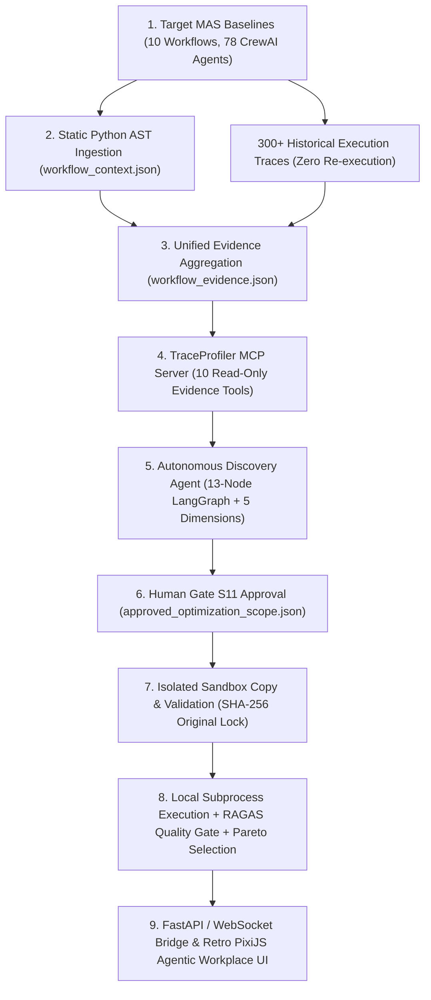
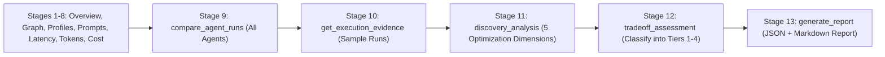
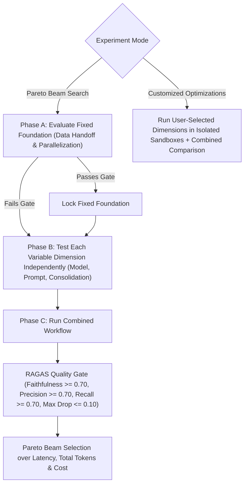
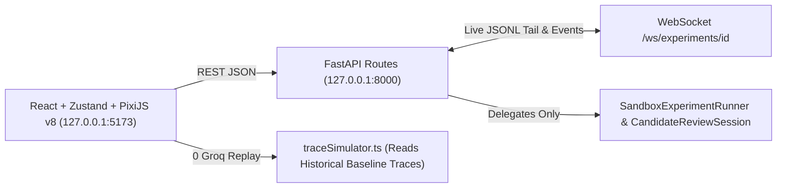
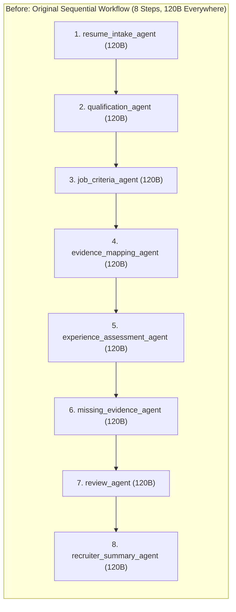
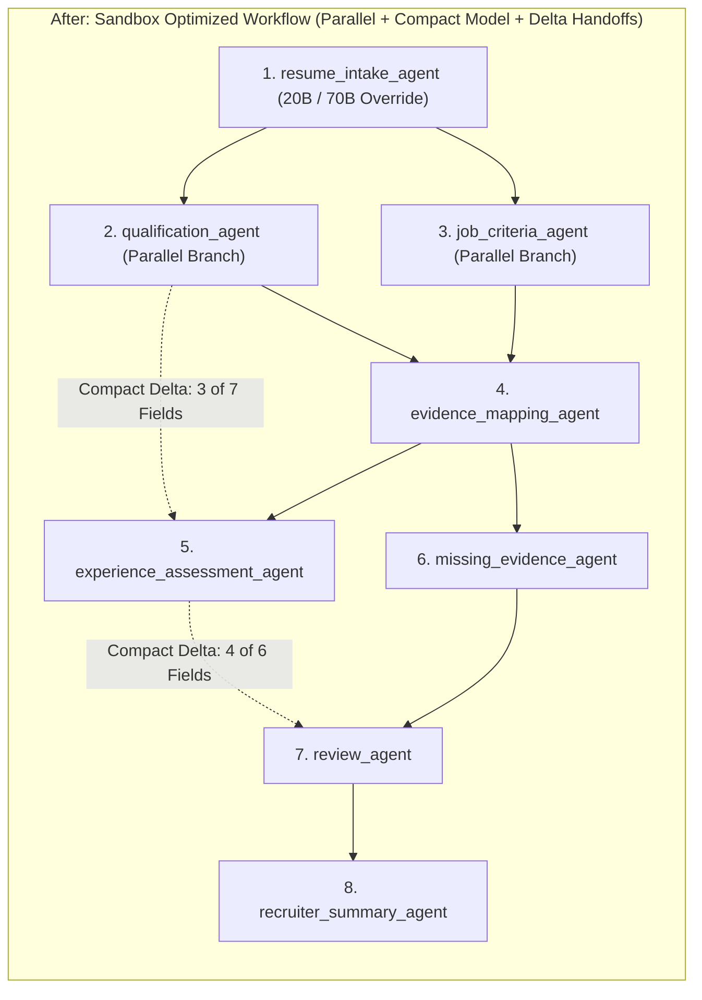

# Agentic Workflow Optimizer (AWO) & TraceProfiler — Deep Iterative Technical & Plain-English Blueprint (`FINAL_BRAIN.md`)

> **What This Document Gives You:** A step-by-step, chronological walkthrough of how the entire project was engineered — starting from **Iteration 1 (creating 10 CrewAI workflows with 78 agents)** all the way to **Iteration 9 (Two-Phase Pareto Beam Search, FastAPI WebSockets, and the Retro PixiJS Agentic Workplace UI)**.  
> Every iteration explains **what happens under the hood**, shows the **exact Python/TypeScript code from our repo**, and immediately translates that code into **simple, everyday English**.

---

## 1. End-to-End Architecture Flow



---

## 2. Iterative Under-the-Hood Walkthrough (Iterations 1 -> 9)

---

### Iteration 1 — Building the 10 Target MAS Baselines (`Agents/`, `common/`, `data/`)

At the start of the project, we needed 10 realistic business multi-agent workflows built consistently so we could measure and optimize them fairly.

#### Exact Implementation Under the Hood

1. **Shared CrewAI + Groq Runtime (`common/agent_runner.py`):** Instead of each workflow wiring LLMs inconsistently, every single agent goes through `create_crew_agent()` and `create_groq_llm_for_agent()`. It enforces Groq's `openai/gpt-oss-120b` (`MANDATORY_MODEL` in `common/settings.py`), routes each workflow/agent to its assigned key via `get_key_for_agent()`, strips unsupported Anthropic-style `cache_breakpoint` dicts that Groq rejects, and tells LiteLLM to drop unsupported parameters.
2. **Modular Workflow Orchestration (`Agents/<workflow>/workflow.py`):** Each workflow has its own folder under `Target-MAS-Dataset-main/Agents/` containing `workflow.json`, `workflow.py`, and one `.py` file per CrewAI agent. Every agent returns structured Pydantic JSON (`common/validation.py`), and `MetricsTracker` (`common/metrics.py`) + Arize Phoenix OpenTelemetry spans (`common/tracing.py`) record timing, tokens, and USD cost into `runs/` and `Ingestion_Traces_final/`.

**Snippet 1A — Enforcing Uniform Groq Model & Key Isolation (`common/agent_runner.py`):**
```python
# Ensure LiteLLM drops unsupported parameters before sending to Groq
litellm.drop_params = True

# Groq's API strictly rejects 'cache_breakpoint' in message dictionaries.
try:
    import crewai.llms.cache
    crewai.llms.cache.mark_cache_breakpoint = lambda msg: msg
except Exception:
    pass

def create_groq_llm_for_agent(agent_id: str) -> Tuple[Any, str]:
    raw_key, env_var, safe_id = get_key_for_agent(agent_id)
    from crewai import LLM

    # Configured strictly with groq provider and mandatory model openai/gpt-oss-120b
    llm = LLM(
        model=f"groq/{MANDATORY_MODEL}",
        api_key=raw_key,
        temperature=0.1
    )
    return llm, safe_id
```

**Snippet 1B — Sequential 8-Agent Baseline Chain (`Agents/recruitment_screening/workflow.py`):**
```python
        # Instantiate all 8 CrewAI agents
        self.agent_1_intake = intake_agent.create_agent(llm=self.llm)
        self.agent_2_qualification = qualification_agent.create_agent(llm=self.llm)
        self.agent_3_job_criteria = job_criteria_agent.create_agent(llm=self.llm)
        ...

            # Stage 1: Resume Intake Agent
            intake_res = intake_agent.run_intake(
                resume_data=resume_data,
                agent=self.agent_1_intake,
                tracker=tracker,
            )

            # Stage 2: Qualification Extraction Agent
            qual_res = qualification_agent.run_qualification_extraction(
                intake_output=intake_res,
                agent=self.agent_2_qualification,
                tracker=tracker,
            )

            # Stage 3: Job Criteria Agent
            job_crit_res = job_criteria_agent.run_job_criteria(
                job_data=job_data,
                agent=self.agent_3_job_criteria,
                tracker=tracker,
            )
```

> **How This Code Works in Simple Words:**  
> Think of `common/agent_runner.py` as the **company travel & IT desk**. Whenever any of the 78 agents starts up, this code forces everyone to use the exact same brain (`openai/gpt-oss-120b`), gives them their own badge (`GROQ_API_KEY_*`) so one workflow never exhausts another workflow's rate limit, and strips away headers (`cache_breakpoint`) that Groq doesn't understand. Meanwhile, `workflow.py` calls Agents 1 through 8 strictly one after another in a single-file line and hands `tracker` around to clock how long each agent took and how many tokens it spent.

#### Inventory of All 10 Target Workflows (78 Agents Total)

| # | Workflow ID | Agents | Baseline Model | Primary Business Task |
| :--- | :--- | :---: | :--- | :--- |
| 1 | `contract_review` | 10 | `openai/gpt-oss-120b` | Extract clauses, flag legal/compliance risks, summarize redlines |
| 2 | `market_research` | 9 | `openai/gpt-oss-120b` | Collect competitor/market signals, synthesize insights & forecast |
| 3 | `procurement_supplier_selection` | 9 | `openai/gpt-oss-120b` | Evaluate supplier bids with weighted math scoring + risk review |
| 4 | `expense_reimbursement` | 8 | `openai/gpt-oss-120b` | Audit receipts against expense policy, flag anomalies & approve |
| 5 | `invoice_processing` | 8 | `openai/gpt-oss-120b` | Extract line items, match POs, run tax/math verification |
| 6 | `recruitment_screening` | 8 | `openai/gpt-oss-120b` | Parse resume & job criteria, map evidence, score fit & summarize |
| 7 | `incident_triage` | 7 | `openai/gpt-oss-120b` | Classify severity, correlate logs, route & recommend remediation |
| 8 | `sales_lead_qualification` | 7 | `openai/gpt-oss-120b` | Enrich lead profile, score BANT/ICP fit & draft outreach strategy |
| 9 | `customer_support` | 6 | `openai/gpt-oss-120b` | Classify ticket, retrieve policy, investigate root cause & respond |
| 10 | `inventory_replenishment` | 6 | `openai/gpt-oss-120b` | Analyze stock velocity, supplier lead times & reorder quantities |
| **Total** | **10 Workflows** | **78** | **Groq (`openai/gpt-oss-120b`)** | **Zero-mutation baseline reference suite** |

---

### Iteration 2 — Static Python AST Ingestion (`ingestion/`, `schemas/`)

Before optimizing any workflow, the system must understand how it is written **without spending a single Groq API call or running any code**.

#### Exact Implementation Under the Hood

`ingestion/ast_parser.py`, `ingestion/agent_extractor.py`, and `ingestion/workflow_analyzer.py` parse the Python files using Python's built-in Abstract Syntax Tree (`ast`) module, extracting clean Pydantic-validated `workflow_context.json` blueprints.

**Snippet 2 — Structured AST Extraction Models (`ingestion/agent_extractor.py`):**
```python
@dataclass
class ExtractedAgent:
    agent_id: str
    name: str
    definition_type: str  # "function" | "class" | "assignment"
    source_file: str
    start_line: int
    end_line: int
    role: Optional[str] = None
    goal: Optional[str] = None
    backstory: Optional[str] = None
    llm: ExtractedLLM = field(default_factory=ExtractedLLM)
    tasks: List[ExtractedTask] = field(default_factory=list)
    registered_tools: List[str] = field(default_factory=list)
    helper_functions: List[str] = field(default_factory=list)
    explicit_code_invocations: List[str] = field(default_factory=list)
    evidence_refs: List[str] = field(default_factory=list)
    raw_node: Optional[ast.AST] = None
```

> **How This Code Works in Simple Words:**  
> Instead of running the Python scripts, this step uses an X-ray machine (`ast`) to read the source files like text blueprints. For every agent, it fills out an `ExtractedAgent` card: exact file path, line numbers, its `role` / `goal` / `backstory`, its task prompts (`tasks`), and any deterministic Python helper functions it calls (`helper_functions`). Zero LLMs are called here — it is 100% static and instantaneous.

---

### Iteration 3 — Unified Evidence Aggregation (`evidence_aggregation/`, `Workflow_Evidence/`)

Static code tells you *how* agents are wired, while traces (`Ingestion_Traces_final/`) tell you *what actually happened at runtime*. `EvidenceAggregator` fuses both into `Workflow_Evidence/<workflow_id>/workflow_evidence.json`.

#### Exact Implementation Under the Hood

**Snippet 3 — Fusing Static & Runtime Sources (`evidence_aggregation/aggregator.py`):**
```python
    def aggregate_workflow(self, workflow_id: str) -> WorkflowEvidenceDocument:
        """Consolidate declared, static, and runtime evidence for a single workflow."""
        wf_dir = self.agents_dir / workflow_id
        wf_json_path = wf_dir / "workflow.json"
        wf_ctx_path = wf_dir / "workflow_context.json"
        trace_wf_dir = self.traces_dir / workflow_id
        ...
        # Load runtime trace files (live_*.json)
        if trace_wf_dir.exists():
            trace_files = sorted([f.name for f in trace_wf_dir.glob("live_*.json")])
        ...
        # 2. Build Workflow Definition (from workflow.json)
        workflow_definition = self._build_workflow_definition(wf_json_data)
        # 3. Build Static Implementation Context (from workflow_context.json)
        static_context = self._build_static_context(wf_ctx_data)
        # 4. Build Runtime Observations (from traces_data)
        runtime_observations = self._build_runtime_observations(traces_data)
        # 5. Build Workflow Graph (nodes & edges across all 3 tiers)
        workflow_graph = self._build_workflow_graph(
            workflow_id=workflow_id,
            definition=workflow_definition,
            static_context=static_context,
            runtime_obs=runtime_observations,
        )
        # 6. Build Reconciliation and Limitations
        reconciliation = self._build_reconciliation(...)
```

> **How This Code Works in Simple Words:**  
> This function acts like a **black-box flight data compiler**. It opens 3 folders at once: (1) the intended design (`workflow.json`), (2) the X-ray from Iteration 2 (`workflow_context.json`), and (3) every historical run log (`live_*.json`). It stitches them into one file (`workflow_evidence.json`) containing mean/median latency, prompt/completion tokens, USD costs, actual JSON fields passed between agents, and any mismatches ("reconciliation") between what the code *claims* vs. what actually *ran*.

---

### Iteration 4 — TraceProfiler MCP Evidence Server (`mcp_server/`)

Next, we needed a safe, standardized way for downstream optimization agents (or external AI tools) to query `workflow_evidence.json` without loading 50,000-line JSON dumps or accidentally reading arbitrary files on disk.

#### Exact Implementation Under the Hood

`mcp_server/server.py` wraps `mcp_server/tools.py` inside the official Python `MCPServer` SDK, exposing **10 read-only tools** guarded by strict directory confinement.

**Snippet 4 — Path-Traversal Security & Read-Only Evidence Loading (`mcp_server/tools.py`):**
```python
def _validate_workflow_id(workflow_id: str, base_dir: Path) -> Tuple[Optional[Path], Optional[Dict[str, Any]]]:
    if not workflow_id or not isinstance(workflow_id, str):
        return None, {"error": "workflow_id must be a non-empty string."}

    # Reject path traversal tokens and invalid directory characters
    invalid_patterns = ["..", "/", "\\", ":", "\0", "~", "*", "?", "<", ">", "|"]
    if any(p in workflow_id for p in invalid_patterns):
        return None, {
            "error": f"Invalid workflow_id '{workflow_id}': path traversal or invalid path characters detected."
        }

    resolved_base = base_dir.resolve()
    target_path = (resolved_base / workflow_id / "workflow_evidence.json").resolve()

    # Ensure target_path remains inside resolved_base
    try:
        target_path.relative_to(resolved_base)
    except ValueError:
        return None, {
            "error": f"Path traversal detected: '{workflow_id}' resolves outside the evidence directory."
        }

    return target_path, None
```

The **10 registered MCP tools** in `mcp_server/server.py` (`@server.tool(...)`):
1. `list_workflows` | 2. `get_workflow_overview` | 3. `get_workflow_graph` (with `include_isolated_nodes=True`) | 4. `get_agent_profiles` | 5. `get_prompt_metrics` (`full_prompt` or truncated) | 6. `get_latency_metrics` | 7. `get_token_metrics` | 8. `get_cost_metrics` | 9. `compare_agent_runs` | 10. `get_execution_evidence` (`agent_id` + `run_id`).

> **How This Code Works in Simple Words:**  
> Think of the MCP server as a **bank teller behind bulletproof glass**. Before opening any file, `_validate_workflow_id` checks the requested `workflow_id` for trick characters like `..` or `/` (`../../etc/passwd`) and proves the final resolved path stays strictly inside `Workflow_Evidence/`. Then each of the 10 tools only hands over the exact slice asked for (e.g., *only* latency numbers, or *only* prompt token stats).

---

### Iteration 5 — Autonomous Optimization Discovery Agent (`optimization_agent/`)

With MCP tools ready, we built the brain that actually discovers where to optimize each workflow across **5 optimization dimensions** using **LangGraph** and **task-allocated Groq keys**.



#### Exact Implementation Under the Hood

**Snippet 5A — 13-Stage Sequential LangGraph Pipeline (`optimization_agent/agent.py`):**
```python
def build_optimization_graph() -> Any:
    """Build and compile the 13-stage sequential LangGraph StateGraph."""
    builder = StateGraph(OptimizationAgentState)

    # Register all 13 nodes
    builder.add_node("stage_1_discovery", stage_1_discovery)
    builder.add_node("stage_2_overview", stage_2_overview)
    builder.add_node("stage_3_graph", stage_3_graph)
    builder.add_node("stage_4_profiles", stage_4_profiles)
    builder.add_node("stage_5_prompts", stage_5_prompts)
    builder.add_node("stage_6_latency", stage_6_latency)
    builder.add_node("stage_7_tokens", stage_7_tokens)
    builder.add_node("stage_8_cost", stage_8_cost)
    builder.add_node("stage_9_comparison", stage_9_comparison)
    builder.add_node("stage_10_evidence", stage_10_evidence)
    builder.add_node("discovery_analysis", discovery_analysis)
    builder.add_node("tradeoff_assessment", tradeoff_assessment)
    builder.add_node("generate_report", generate_report)

    # Strictly sequential execution order
    builder.add_edge(START, "stage_1_discovery")
    ...
    builder.add_edge("stage_10_evidence", "discovery_analysis")
    builder.add_edge("discovery_analysis", "tradeoff_assessment")
    builder.add_edge("tradeoff_assessment", "generate_report")
    builder.add_edge("generate_report", END)

    return builder.compile()
```

> **How Snippet 5A Works in Simple Words:**  
> This builds an **automated assembly line with 13 stations**. Stations 1 through 10 pull clean evidence from the MCP server one step at a time (never skipping an agent). Station 11 (`discovery_analysis`) searches for speed/cost wins across the 5 dimensions. Station 12 (`tradeoff_assessment`) grades each idea into **Tier 1** (safe immediate win), **Tier 2** (needs validation), **Tier 3** (risky caution), or **Tier 4** (not enough evidence). Station 13 writes the final `.json` and `.md` discovery reports.

**Snippet 5B — Strict Parallelization Dependency Proof (`optimization_agent/discovery.py`):**
```python
def verify_dependency_independence(
    agent_a: str,
    agent_b: str,
    reachability: Dict[str, Set[str]],
    profiles: Dict[str, Any],
) -> Tuple[bool, str]:
    # 1. Graph topological reachability check
    a_reaches_b = agent_b in reachability.get(agent_a, set())
    b_reaches_a = agent_a in reachability.get(agent_b, set())

    if a_reaches_b:
        return False, f"Direct or transitive graph dependency detected: {agent_a} -> ... -> {agent_b}"
    if b_reaches_a:
        return False, f"Direct or transitive graph dependency detected: {agent_b} -> ... -> {agent_a}"

    # 2. Input/output overlap check
    ...
    if a_outs.intersection(b_ins):
        return False, f"Data dependency: {agent_b} inputs intersect with {agent_a} outputs."
    if b_outs.intersection(a_ins):
        return False, f"Data dependency: {agent_a} inputs intersect with {agent_b} outputs."

    return True, f"Verified independent: No direct/transitive edge between {agent_a} and {agent_b}, and no shared I/O coupling."
```

> **How Snippet 5B Works in Simple Words:**  
> Before claiming two agents can run at the exact same time, this check tests **two hard rules**: (1) does Agent A reach Agent B *anywhere* downstream in the dependency graph (even 3 hops away)? and (2) do the output fields written by A overlap with the input fields read by B? Only if *both* checks pass is the pair marked **Tier 1 safe to parallelize**.

**Snippet 5C — Two-Agent JEV Model Selection Subgraph (`optimization_agent/model_selection/orchestrator.py`):**
```python
def build_model_selection_graph() -> Any:
    """Build and compile the 2-node sequential LangGraph StateGraph."""
    graph_builder = StateGraph(AWOModelSelectionState)
    graph_builder.add_node("requirement_analyzer", requirement_analyzer_node)
    graph_builder.add_node("model_selector", model_selector_node)

    graph_builder.add_edge(START, "requirement_analyzer")
    graph_builder.add_edge("requirement_analyzer", "model_selector")
    graph_builder.add_edge("model_selector", END)

    return graph_builder.compile()

def run_model_selection(...):
    # 1. MCP Evidence Retrieval and Context Building
    agent_context = build_agent_context_from_mcp(...)
    # 2. Groq Model Discovery and Capability Merging
    available_llms, missing_from_api = resolve_available_llms(live_models=live_groq_models)
    # 3. Deterministic Eligibility Filtering
    eligible_llms, excluded_llms = filter_eligible_models(
        available_llms=available_llms,
        agent_context=agent_context,
    )
    # 4. LangGraph Sequential Execution -> requirement_analyzer -> model_selector
```

> **How Snippet 5C Works in Simple Words:**  
> Instead of blindly downsizing models, JEV (`model_selection/`) runs a careful 4-step funnel: first it pulls the agent's real token/prompt stats via MCP, checks Groq's catalog, **deterministically disqualifies** models whose context window or JSON support is too small, and then runs two specialist agents — Agent 1 diagnoses how hard the agent's job actually is (simple text parsing vs. complex reasoning), and Agent 2 picks compact candidates (like `openai/gpt-oss-20b` or `llama-3.3-70b-versatile`) flagged `requires_validation = True`.  
> Meanwhile, **Agent Consolidation** applies a 70% context-window cap + 50% token segmentation filter, **Prompt Optimization** strips repeated bloat and verifies schema preservation, and **Communication/Data Handoff** trims unused JSON keys between agents.

---

### Iteration 6 — Human-in-the-Loop Approval Gate (`optimization_agent/review/`, `api/routes/workflows.py`)

Nothing enters a sandbox experiment unless a human reviews and approves it. Notice how **both** the legacy Streamlit S11 UI and the new React UI call the **exact same `CandidateReviewSession` backend class**.

#### Exact Implementation Under the Hood

**Snippet 6A — Risk Enforcement & Approval Scope Persistence (`optimization_agent/review/session.py`):**
```python
        # Default preselection: Tiers 1, 2, 3 preselected; Tier 4 excluded.
        # Preselection is NEVER approval.
        self.selected_candidate_ids: Set[str] = set(self.eligible_candidate_ids)
        ...
        unacknowledged: List[str] = []
        for cid in ids_to_check:
            cand = self._candidates_by_id.get(cid)
            if cand and get_risk_info(cand)["requires_risk_acknowledgement"]:
                if cid not in self.risk_acknowledged_candidate_ids:
                    unacknowledged.append(cid)

        if unacknowledged:
            errors.append(
                "Risk acknowledgement required before approval for candidate(s): "
                + ", ".join(unacknowledged)
            )
```

**Snippet 6B — FastAPI In-Browser Approval Bridge (`api/services/artifact_service.py`):**
```python
    def approve_workflow_candidates(
        self,
        workflow_id: str,
        selected_candidate_ids: List[str],
        risk_acknowledged_candidate_ids: List[str],
    ) -> Dict[str, Any]:
        self._resolve_workflow_dir(workflow_id)
        wf_id = validate_safe_id(workflow_id, "workflow_id")
        session = CandidateReviewSession.from_workflow_id(wf_id, reports_dir=self.reports_dir)
        session.clear_selection()
        selected_set = {str(cid) for cid in selected_candidate_ids}
        for cid in selected_candidate_ids:
            try:
                session.select_candidate(str(cid))
            except KeyError as exc:
                raise ValueError(str(exc)) from exc

        for cid in risk_acknowledged_candidate_ids:
            if str(cid) in selected_set:
                session.acknowledge_risk(str(cid), True)

        scope = session.approve(
            expected_workflow_id=wf_id,
            persist=True,
            output_dir=self.reports_dir,
        )
        return self.sanitize_obj(scope)
```

> **How These Snippets Work in Simple Words:**  
> Think of `CandidateReviewSession` as a **two-key launch switch**. Even though the discovery report highlights recommended Tier 1–3 ideas by default, *"Preselection is NEVER approval"*: the backend clears defaults, checks every candidate the human actually ticked, refuses to approve if any Tier 3 / moderate-risk change wasn't explicitly acknowledged (`Acknowledge Risk` checkbox), and only then writes `reports/<workflow_id>_approved_optimization_scope.json` so live experiments unlock.

---

### Iteration 7 — Isolated Sandbox Engine & Local Subprocess Runner (`optimization_agent/sandbox/`)

Once `<workflow_id>_approved_optimization_scope.json` exists, we must execute the optimized workflow **without touching `Agents/<workflow_id>/`** and **without re-running the baseline**.

#### Exact Implementation Under the Hood

**Snippet 7A — Directory Lock & SHA-256 Tamper Check (`optimization_agent/sandbox/manager.py`):**
```python
def assert_path_inside_sandbox(target_path: Union[str, Path], sandbox_dir: Union[str, Path]) -> Path:
    resolved_target = Path(target_path).resolve()
    resolved_sandbox = Path(sandbox_dir).resolve()
    if not resolved_target.is_relative_to(resolved_sandbox):
        raise PermissionError(
            f"Refused write outside sandbox directory: '{resolved_target}' is not inside '{resolved_sandbox}'."
        )
    return resolved_target

def compute_directory_hashes(directory: Union[str, Path]) -> Dict[str, str]:
    """Compute SHA-256 hex digests for all .py and .json files in directory."""
    ...
        hashes[rel] = hashlib.sha256(p.read_bytes()).hexdigest()
    return hashes

    if scope.get("approval_status") != "approved":
        raise ValueError(...)
```

**Snippet 7B — Sandbox-First Subprocess Isolation (`optimization_agent/sandbox/runtime/process_manager.py`):**
```python
def build_subprocess_env(
    *,
    workflow_id: str,
    workflow_dir: Path,
    project_root: Path,
    key_mgr: Optional[GroqKeyManager] = None,
) -> Dict[str, str]:
    sub_env: Dict[str, str] = {}
    for var in _SAFE_SYSTEM_ENV_VARS:
        val = os.environ.get(var)
        if val:
            sub_env[var] = val

    sub_env["PYTHONPATH"] = f"{workflow_dir.resolve()}{os.pathsep}{project_root.resolve()}"
    sub_env["AWO_ACTIVE_WORKFLOW_DIR"] = str(workflow_dir.resolve())
    ...
    for key_var in required_key_vars:
        raw_val = (mgr._keys.get(key_var) or os.environ.get(key_var) or "").strip()
        if raw_val:
            sub_env[key_var] = raw_val
    return sub_env
```

> **How These Snippets Work in Simple Words:**  
> First, `SandboxManager` fingerprints every `.py` and `.json` file in your original `Agents/<workflow_id>/` using SHA-256 hashes, copies the files into `reports/experiments/<workflow_id>/<exp_id>/sandbox_workflow/`, and enforces `assert_path_inside_sandbox()` so executors physically *cannot* write outside the copy.  
> Next, when running the modified code, `build_subprocess_env()` puts the **sandbox folder first** on `PYTHONPATH` so Python imports the patched sandbox agents instead of the originals, and injects Groq API keys strictly through environment variables (never CLI flags or logs). Before returning, `verify_original_unchanged()` checks every SHA-256 hash again to guarantee your originals were never modified (`True`). Meanwhile, `baseline_loader.py` matches the exact same inputs against historical traces (`0` baseline Groq API calls).

---

### Iteration 8 — Two-Phase Pareto Beam Search, RAGAS Quality Gate & Customized Optimizations

Speed means nothing if an agent starts hallucinating or dropping fields. So we built a strict **RAGAS Quality Gate** paired with a **Non-Dominated Pareto Selector**.



#### Exact Implementation Under the Hood

**Snippet 8A — Strict RAGAS Acceptance & Evaluator Cost Isolation (`optimization_agent/sandbox/evaluation/ragas_evaluator.py`):**
```python
def _new_eval_usage_tracker(model_id: str, evaluator_backend: str) -> Dict[str, Any]:
    return {
        "evaluator_backend": evaluator_backend,
        "model": model_id,
        "api_calls": 0,
        "prompt_tokens": 0,
        "completion_tokens": 0,
        "total_tokens": 0,
        "estimated_cost_usd": 0.0,
        "isolated_from_workflow_metrics": True,
    }

def evaluate_quality_acceptance(...):
    if not validation_passed or not execution_passed or not schema_valid:
        ...
        return {"quality_accepted": False, "status": "rejected", "reasons": reasons, ...}

    if not eff_criteria.has_configured_thresholds():
        reasons.append(
            "No quality acceptance thresholds configured (...); refusing to invent thresholds."
        )
        return {"quality_accepted": False, "status": "inconclusive", ...}

    for metric, min_val in min_map.items():
        ...
        ok = float(actual) >= float(min_val)
        if not ok:
            failed_checks.append(f"{metric}={actual:.4f} < configured minimum {min_val:.4f}")
```

**Snippet 8B — Non-Dominated Pareto Frontier Filter (`optimization_agent/sandbox/evaluation/workflow_selector.py`):**
```python
def _dominates(a: Dict[str, Any], b: Dict[str, Any]) -> bool:
    """
    Return True iff configuration a Pareto-dominates b over (mean_latency_seconds,
    mean_tokens, mean_cost_usd) -- strictly better on at least one objective and no worse on any.
    """
    objs = ("mean_latency_seconds", "mean_tokens", "mean_cost_usd")
    strictly_better = False
    comparable_count = 0
    for k in objs:
        va = a.get(k)
        vb = b.get(k)
        if not isinstance(va, (int, float)) or not isinstance(vb, (int, float)):
            continue
        comparable_count += 1
        if float(va) > float(vb):
            return False
        if float(va) < float(vb):
            strictly_better = True
    return comparable_count > 0 and strictly_better

def select_best_workflows_pareto(configurations: List[Dict[str, Any]]) -> Dict[str, Any]:
    for cfg in configurations:
        if not cfg.get("validation_passed", False): reasons.append("validation_failed")
        if not cfg.get("execution_passed", False): reasons.append("execution_failed")
        if not cfg.get("quality_accepted", False): reasons.append(...)
```

> **How These Snippets Work in Simple Words:**  
> Think of Snippet 8A as an **exam proctor**: if an optimized workflow crashes, breaks output schemas, or scores below `0.70` on `Faithfulness`, `Context Precision`, or `Context Recall` (or regresses more than `0.10` vs. the Phase A foundation), it immediately marks it **`rejected`** — never faking missing metrics as zero and carefully separating the RAGAS judge's own token bill (`isolated_from_workflow_metrics: True`) so it doesn't pollute the workflow's metrics.  
> Then Snippet 8B acts as the **awards committee**: it disqualifies every `rejected` or failed run first, and among survivors checks `_dominates(a, b)` mathematically across **latency, tokens, and cost** — choosing only configurations that are not strictly beaten on all 3 fronts.  
> In Tab 2 of the UI, **`Pareto Beam Search`** (`two_phase_study`) runs this complete Phase A -> Phase B -> Phase C + Pareto pipeline automatically, while **`Customized Optimizations`** (`dimension_ablation_suite`) lets the user check any 1 or more dimensions to test side-by-side.

---

### Iteration 9 — Thin FastAPI/WebSocket Bridge (`api/`) & Retro PixiJS Agentic Workplace UI (`frontend/`)

Finally, we turned the backend into a live interactive simulation & control center without duplicating any backend logic in the UI.



#### Exact Implementation Under the Hood

**Snippet 9A — Automatic Topology-to-Floorplan Layout (`frontend/src/office/officeLayout.ts`):**
```ts
export function computeTopologicalStages(
  agents: AgentProfile[],
  executionOrder: string[]
): Map<string, number> {
  const agentMap = new Map(agents.map((a) => [a.agent_id, a]));
  const stages = new Map<string, number>();

  const visit = (id: string, visiting = new Set<string>()): number => {
    if (stages.has(id)) return stages.get(id)!;
    if (visiting.has(id)) return 0;
    visiting.add(id);
    const agent = agentMap.get(id);
    if (!agent?.dependencies?.length) {
      stages.set(id, 0);
      return 0;
    }
    let maxDep = -1;
    for (const dep of agent.dependencies) {
      if (agentMap.has(dep)) maxDep = Math.max(maxDep, visit(dep, visiting));
    }
    const lvl = maxDep + 1;
    stages.set(id, lvl);
    return lvl;
  };
```

**Snippet 9B — Zero-Groq Historical Wave Replay (`frontend/src/store/traceSimulator.ts`):**
```ts
  const allowParallel =
    activeDimension === 'workflow_parallelization' || activeDimension === 'all_combined';
  if (!allowParallel) {
    return order.map((id) => [id]);
  }

  const completed = new Set<string>();
  const remaining = [...order];
  const waves: string[][] = [];
  while (remaining.length > 0) {
    const ready = remaining.filter((id) =>
      (byId.get(id)?.dependencies || []).every((dep) => completed.has(dep) || !byId.has(dep))
    );
    const wave = ready.length > 0 ? ready : [remaining[0]];
    waves.push(wave);
    ...
  }
  return waves;
```

> **How These Snippets Work in Simple Words:**  
> Why does the pixel-art office automatically rearrange desks cleanly whether you pick 6-agent `customer_support`, 8-agent `recruitment_screening`, or 10-agent `contract_review`? Because Snippet 9A computes each agent's **column depth dynamically** from its AST `dependencies`! Whenever two agents share the same dependency stage (like `qualification_agent` and `job_criteria_agent`), they line up in the same vertical column so you can visually see parallelization!  
> And when you hit **Play** on Tab 1 (`OfficePage.tsx`), Snippet 9B computes sequential waves vs. concurrent parallel waves from your recorded historical trace (`Ingestion_Traces_final/`) — animating packets, speech bubbles, latency, tokens, and outputs **with 0 Groq API calls**. Across the top nav bar, 5 pages cover the entire lifecycle: `OfficePage` (visual floor + inspector), `ExperimentsPage` (`Pareto Beam Search` vs. `Customized Optimizations` + inline Human Gate Approval), `QualityLabPage` (RAGAS + Pareto table), `PerformanceReviewPage` (delta charts + SHA-256 verification), and `ReportsPage` (rendered Markdown/JSON reports), all launchable via **`run_workplace.bat`**.

---

## 3. Concrete Before vs. After Case Study: `recruitment_screening`

### 3A. Workflow Graph Transformation (Before -> After)





### 3B. Exact Code Added in the Sandbox Copy (`wp_20261124_183147_914004/combined/sandbox_workflow/`)
*(Note: `Agents/recruitment_screening/` originals had 0 bytes changed — verified by SHA-256 across all 12 files.)*

**1. Parallel Execution Hook Injected into Sandbox `workflow.py`:**
```python
# Applied by AWO Sandbox Executor
PARALLEL_GROUPS = [['qualification_agent', 'job_criteria_agent']]

from concurrent.futures import ThreadPoolExecutor as _AWOThreadPoolExecutor

def run_parallel_group(tasks_map):
    """Execute independent agent callables concurrently and synchronize outputs."""
    with _AWOThreadPoolExecutor(max_workers=max(1, len(tasks_map))) as pool:
        futures = {name: pool.submit(fn) for name, fn in tasks_map.items()}
        return {name: fut.result() for name, fut in futures.items()}
```

**2. Typed Compact Handoff Projection Injected into Sandbox `workflow.py`:**
```python
# Applied by AWO Sandbox Executor
HANDOFF_PROJECTIONS = {
    'qualification_agent->experience_assessment_agent': {
        'retained_fields': ['candidate_id', 'technical_skills', 'experience_records'],
        'excluded_fields': ['education', 'certifications', 'projects', 'extraction_warnings'],
    },
    'experience_assessment_agent->screening_review_agent': {
        'retained_fields': ['candidate_id', 'strengths', 'experience_gaps', 'evidence_references'],
        'excluded_fields': ['relevance_summary', 'transferable_skills'],
    },
}

def project_handoff_payload(producer, consumer, payload):
    """Project approved compact fields on configured edges; pass through unapproved edges unchanged."""
    if not isinstance(payload, dict):
        return payload
    spec = HANDOFF_PROJECTIONS.get(f'{producer}->{consumer}')
    if not spec:
        return payload
    retained = set(spec.get('retained_fields') or [])
    return {k: v for k, v in payload.items() if k in retained}
```

**3. Compact Model Override Appended to Sandbox `intake_agent.py`:**
```python
# Applied by AWO Sandbox Executor (using openai/gpt-oss-20b in live_validation_recruitment_screening,
# or llama-3.3-70b-versatile in wp_20261124_183147_914004)
MODEL_OVERRIDE = 'openai/gpt-oss-20b'
```

> **How These Before/After Code Changes Work in Simple Words:**  
> 1. **Parallelization (`run_parallel_group`):** Instead of waiting `3.41s` for Qualification Extraction and then another `2.82s` for Job Criteria (`6.23s` total), Python launches both in a `ThreadPoolExecutor` simultaneously (**projected branch latency `6.23s -> 3.41s`, `-45.3%`**).  
> 2. **Communication Trimming (`project_handoff_payload`):** Before passing JSON from `qualification_agent` to `experience_assessment_agent`, 4 unused fields (`education`, `certifications`, `projects`, `extraction_warnings`) are filtered out on the wire — shrinking payload bloat without altering global state.  
> 3. **Model Selection (`MODEL_OVERRIDE`):** Only `resume_intake_agent` (straightforward section parsing) drops from `120B` down to `20B` while all downstream judgment/audit agents stay on `120B`.

---

## 4. How Much Optimization We Achieved (Discovery vs. Real Live Sandbox Results)

### 4A. Discovery Stage Projections (`reports/*_optimization_report.md`)

| Workflow | Discovered Candidates | Baseline Evidence (30 Runs) | Projected Savings (Discovery) | Specific Bottlenecks Found |
| :--- | :---: | :--- | :--- | :--- |
| **`recruitment_screening`** (8 agents) | **12** (1 Tier 1, 11 Tier 2) | `44.80s` mean (`30.60s` median), `16,910` tokens, `$0.0113`/run | **~35% critical-path latency**, **~28% tokens**, **~32% cost**; all 10 handoffs combined save `667` payload tokens (**`-17.07%`**, `3,907 -> 3,240`) | `qualification_agent` + `job_criteria_agent` parallel branch (`6.23s -> 3.41s`, **`-45.3%`**); `resume_intake_agent` compact model (`-40%` projected) |
| **`contract_review`** (10 agents) | **9** (1 Tier 1, 8 Tier 2) | `57.13s` mean (`30.66s` median), `17,515` tokens, `$0.0121`/run | **~35% critical-path latency**, **~28% tokens**, **~32% cost** | `compliance_deviation_agent` (`1.85s`) + `risk_ambiguity_agent` (`3.04s`) parallel branch (`4.88s -> 3.04s`, **`-37.8%`**); 2 intake/clause extraction agents for compact models |

*(Note: Both workflows yielded **0** Consolidation candidates due to the 50% token segmentation safety rule, and **0** Prompt candidates because repetitive prompts failed the strict post-optimization validation guard.)*

### 4B. Live Sandbox Study Metrics (`live_validation_recruitment_screening/study_report.md` & `phase_c/combined/execution_report.md`)

Comparing **live local subprocess Groq runs** (`num_runs=1`) against the fixed historical baseline (`hist_ef23650339c0`, **30 matched inputs, 0 baseline Groq calls**):

| Configuration | Applied Optimization | Exec Passed | Mean Latency | Total Tokens | Cost (USD) | Structural Validity | RAGAS Faithfulness | RAGAS Precision | RAGAS Recall | Quality Gate |
| :--- | :--- | :---: | :---: | :---: | :---: | :---: | :---: | :---: | :---: | :--- |
| **`fixed_historical_baseline`** | None (`120B`, recorded) | Yes | **21.751s** | **15,921** | **$0.005079** | 83.75% | reference | reference | reference | `HISTORICAL_REFERENCE` |
| **`phase_a_communication_data_handoff`** | 2 compact handoff projections | Yes | 74.9607s | 18,013 | $0.005774 | **100.0%** | 0.9167 | 0.9302 | 0.5563 | `rejected` (CR < 0.70) |
| **`phase_a_workflow_parallelization`** | 1 parallel branch (`2` agents) | Yes | 73.1854s | 17,815 | $0.005507 | **100.0%** | **1.0000** | 0.7778 | 0.6667 | `rejected` (CR < 0.70) |
| **`model_selection`** (`gpt-oss-20b`) | `resume_intake_agent -> 20B` | Yes | 71.9968s | 18,692 | $0.005741 | **100.0%** | 0.9730 | **1.0000** | 0.5000 | `rejected` (CR < 0.70) |
| **`combined_workflow`** (`phase_c`) | `resume_intake_agent -> 20B` | Yes | 60.7981s | 17,543 | $0.005126 | **100.0%** | **1.0000** | **1.0000** | 0.5000 | `rejected` (CR < 0.70) |

### 4C. Honest Final Summary of Gains vs. What the Safety Gates Caught

1. **Major Reliability & Schema Quality Gains:**
   - Across `phase_a_communication_data_handoff`, `phase_a_workflow_parallelization`, `model_selection`, and `phase_c_combined` (`openai/gpt-oss-20b`), **Structural Validity jumped from `83.75%` -> `100.0%` (`+19.4%` relative improvement)**.
   - In `phase_c_combined`, **Completeness** improved from `87.50% -> 100.0%`, **Instruction Adherence** improved from `90.83% -> 100.0%`, **RAGAS Faithfulness hit `1.0000`**, and **Context Precision hit `1.0000`**.
2. **Catch #1 — Compact Model Failure Isolation (`wp_20261124_183147_914004`):**
   - While `openai/gpt-oss-20b` achieved `100%` execution & schema validity, testing `llama-3.3-70b-versatile` on `resume_intake_agent` failed (`0/2` passed, `structural_validity = 0.0%`). Because Customized Optimizations / Phase B runs each candidate in isolation, the failure was pinpointed immediately without breaking the codebase.
3. **Catch #2 — Why No Automatic Pareto Winner Was Promoted (`Recommended: None`):**
   - The RAGAS/Pareto Quality Gate (`min_context_recall = 0.70`) caught that **Context Recall (`0.50–0.68`)** and `recruiter_summary_agent.consistency` dropped in the live run, and live Groq wall-clock latency (`60.8s–75.0s`, inflated by live API contention/rate-limiting) was slower than the off-peak historical baseline (`21.75s`).
   - Instead of declaring a false victory, `select_best_workflows_pareto()` rejected all non-conforming runs cleanly (`Original Workflow Unchanged = True`, and **`$0.314411` / `66` RAGAS judge calls** cleanly separated from workflow spend).

---

## 5. Quick Start & Automated Verification Reference

- **Start Backend (`8000`) & Frontend (`5173`) Together:** Double-click `run_workplace.bat` at the repo root and open **`http://127.0.0.1:5173/`**.
- **Directory Architecture Map:** `Target-MAS-Dataset-main/ARCHITECTURE.md`.
- **Test Suites:** `py -3.12 -m pytest` (under `Target-MAS-Dataset-main/tests/`) and `npx tsc --noEmit`, `npm test -- --run`, `npm run build` (under `Target-MAS-Dataset-main/frontend/`).
