# Agentic Workflow Optimizer (AWO) & TraceProfiler

**Course:** Agentic AI (`CSE3101`)  
**Institution:** Department of Computer Science and Engineering, School of Engineering and Technology, BML Munjal University  
**Date:** November 2026  

---

## Declaration by the Candidates

We hereby declare that the project entitled **"Agentic Workflow Optimizer (AWO) & TraceProfiler: Evidence-Driven Structural Analysis, Sandboxed Multi-Dimensional Optimization, and Behavioral Equivalence Evaluation of Multi-Agent AI Systems"** has been carried out to fulfil the partial requirements for completion of the core-elective course **Agentic AI** offered in the 7th Semester of the Bachelor of Technology (B.Tech) program in the Department of Computer Science and Engineering during AY-2026-27 (odd semester). This experimental work has been carried out by us and submitted to the course instructor **Prof. Pranshu Tiwari**. Due acknowledgments have been made in the text of the project to all other materials used. This project has been prepared in full compliance with the requirements and constraints of the prescribed curriculum.

- `<Name & Signature of Student-1>` (`<Enrollment Number of Student-1>`)
- `<Name & Signature of Student-2>` (`<Enrollment Number of Student-2>`)
- `<Name & Signature of Student-3>` (`<Enrollment Number of Student-3>`)
- `<Name & Signature of Student-4>` (`<Enrollment Number of Student-4>`)

**Place:** BML Munjal University  
**Date:** `______` November, 2026

---

## 1. Introduction

Multi-Agent Systems (MAS) powered by Large Language Models (LLMs) distribute complex enterprise and analytical workflows—such as recruitment screening, contract review, invoice processing, and incident triage—across specialized collaborating agents. Evaluating these systems solely on whether they finish a task and return an acceptable answer leaves an important operational blind spot: **an agentic workflow can produce satisfactory outputs and still be computationally inefficient in the way it produces them.**

Not every communication step, verification check, or sequential stage in a workflow is wasteful, since certain handoffs are needed to preserve accuracy. At the same time, production and benchmark agent pipelines frequently incur avoidable computational overheads. Common sources include passing full upstream payloads to agents that require only two fields, running independent tasks sequentially, keeping every node pinned to a 120B-parameter model, and retaining verbose schema preambles across repeated calls. Treating output correctness in isolation hides these token, latency, and monetary costs.

This project investigates the gap between output quality and execution efficiency through **AWO & TraceProfiler**, a research prototype built and tested on a corpus of **10 multi-agent workflows** (**78 agents** total and **300 historical baseline execution traces**, 30 runs per workflow). The system extracts static Python AST workflow graphs, combines them with multi-run runtime telemetry, exposes the merged store through a 10-tool read-only Model Context Protocol (MCP) server, and runs a 13-stage LangGraph discovery pipeline. Candidate changes are gated by human approval, tested inside isolated subprocess sandboxes without mutating original code (verified by SHA-256 checksums), evaluated using either legacy RAGAS or a custom zero-API-cost **3-Layer Behavioral Equivalence** engine, and ranked on a multi-objective Pareto frontier.

---

## 2. Problem Statement

### 2.1 Central Research Problem

Conventional evaluations of LLM-based workflows emphasize task completion and output quality while leaving execution efficiency secondary. The central research question guiding this work is:

> *How can existing multi-agent AI workflows reduce avoidable computational and operational overheads while maintaining the quality and reliability of their outputs?*

Rather than collapsing all inefficiencies into a single cost complaint, we decompose the problem into seven specific areas (`PS-1` through `PS-7`):

| ID | Problem Area | Summary of Issue |
| :--- | :--- | :--- |
| **PS-1** | Satisfactory Outputs Conceal Execution Inefficiency | Output quality and execution efficiency are independent dimensions; passing runs can still repeat work and waste tokens. |
| **PS-2** | Limited Visibility into Runtime Behavior | Static agent code and declared roles do not show actual per-agent latency tails, token skew, or runtime dependencies. |
| **PS-3** | Redundant Agents and Overlapping Roles | Sequential agents sometimes duplicate earlier analyses or checks whose output value does not justify extra inference latency. |
| **PS-4** | Excessive Inter-Agent Communication | Upstream nodes forward full dictionaries and narrative explanations even when downstream consumers only read a few typed fields. |
| **PS-5** | Suboptimal Execution Scheduling | Independent steps wait in sequential queues instead of running concurrently, while naive parallelization breaks data dependencies. |
| **PS-6** | Fixed Model and Prompt Configurations | Assigning identical large models and lengthy templates to simple extraction steps wastes latency and API spend. |
| **PS-7** | Unverified Optimization Changes | Applying latency or token cuts without controlled experiments and regression gates can silently alter final decisions. |

### 2.2 Intended Users and Rationale for a Multi-Agent Solution

Intended users include AI/ML systems engineers maintaining multi-step agent pipelines, technical architects managing LLM latency and token budgets, and researchers studying quality-efficiency trade-offs.

A single monolithic LLM prompt cannot solve this problem reliably because prompt inspection alone cannot measure 30-run variance, verify transitive graph reachability, isolate sandboxed code edits, or prevent decision flips on real JSON payloads. Separating evidence retrieval, deterministic graph analysis, risk classification, isolated execution, and before-versus-after evaluation into specialized pipeline stages provides traceability at every step.

### 2.3 Project Objectives and Scope

The primary objectives of the project are to: (1) identify structural and operational sources of overhead in existing MAS workflows, (2) study how inter-agent dependencies and scheduling affect latency, token count, and cost, (3) explore five concrete optimization levers, (4) verify that output reliability is preserved, (5) evaluate efficiency-quality trade-offs through controlled sandbox experiments, and (6) demonstrate feasibility in an interactive desktop web application. As a research prototype, the system emphasizes reproducible analysis and controlled validation rather than autonomous production deployment without human review.

---

## 3. Literature Review

Recent academic work and industry case studies converge on five connected sources of MAS overhead. *AgentTaxo* (ICLR 2025 Workshop) measures token distributions in collaborative LLM systems and terms repeated inter-agent tokens a "communication tax," reporting duplication rates of **72%** in MetaGPT, **86%** in CAMEL, and **53%** in AgentVerse. *AgentPrune* (*Cut the Crap*, ICLR 2025) prunes redundant communication links and reports **28.1% to 72.8%** token savings across six benchmarks without degrading task performance. On the scheduling front, *LLM-as-Scheduler* (ACL 2026) examines dynamic execution path selection so simpler requests avoid heavyweight sequential stages. For reliability, *MAST* (NeurIPS 2025) studies **1,600+ traces** across seven frameworks and catalogs **14 failure modes** spanning system design, inter-agent misalignment, and verification. Practitioner field guides from *Papaya* (*Context Bloat* and *AI Agent Failure Patterns*, 2026) document how stale context, oversized tool returns, and redundant retries degrade successful executions even when no runtime error occurs.

*(Note: Peer-reviewed conferences such as ICLR, NeurIPS, ACL, and Springer are treated here as primary empirical studies, whereas the 2026 MAS efficiency survey preprint and Papaya articles serve as supporting contextual material.)*

### 3.1 Comparative Literature and Existing Systems Review

| Research / Product | Focus and Key Findings | Identified Limitation / Gap Relative to Project Scope |
| :--- | :--- | :--- |
| **AgentTaxo** *(ICLR Workshop 2025)* | Dissects token distribution across MAS interactions and identifies up to 86% duplicated tokens ("communication tax"). | Quantifies communication redundancy but does not provide an end-to-end structural optimization and testing lifecycle. |
| **AgentPrune / Cut the Crap** *(ICLR 2025)* | Prunes redundant communication edges across MAS topologies, lowering tokens by 28.1%–72.8% on six benchmarks. | Targets communication topology pruning rather than jointly evaluating model sizing, prompts, consolidation, and DAG scheduling. |
| **MAST: Why Do Multi-Agent LLM Systems Fail?** *(NeurIPS 2025)* | Analyzes 1,600+ annotated traces across seven frameworks to define 14 system-design, misalignment, and verification failure modes. | Focuses on classifying outright failures rather than systematically optimizing *successful-but-inefficient* runs. |
| **Papaya: Context Bloat & Agent Failure Patterns** *(Practitioner Guides, 2026)* | Documents context bloat, stale tool state, retry loops, and wasted verification inside production traces. | Offers diagnostic checklists rather than an isolated sandbox experimentation and multi-objective validation engine. |
| **Langfuse** *(Existing Product)* | Provides trace logging, prompt versioning, LLM-as-judge evaluations, and dataset experiment tracking. | Primarily an observability and prompt-eval platform; structural refactoring such as DAG parallelization or payload projection must be built externally. |
| **Arize Phoenix** *(Existing Product)* | Supplies OpenInference/OpenTelemetry tracing (used during our trace collection) and dataset evaluation. | Focuses on trace visibility and evaluation rather than coordinated discovery, human approval gating, and Pareto selection across workflow topology edits. |
| **Microsoft Foundry Agent Optimizer** *(Existing Service)* | Evaluates and tunes agent instructions, tool descriptions, and model selection against baseline datasets. | Targets configured agent parameters within supported ecosystems rather than framework-independent AST reachability analysis and inter-agent field pruning. |

### 3.2 Consolidated Literature Gaps

Five gaps emerge directly from the literature comparison:
- **LG-1 (Static + Runtime Unification):** Combining source-level AST structure and declared dependencies with empirical multi-run trace statistics.
- **LG-2 (Multi-Dimensional Optimization):** Investigating scheduling, model selection, agent consolidation, prompt compression, and data handoffs together.
- **LG-3 (Successful-but-Inefficient Analysis):** Detecting wasted compute in runs that already pass functional checks.
- **LG-4 (Evidence-Backed Governance):** Backing every proposed change with code/trace evidence, dependency checks, and human approval before testing.
- **LG-5 (Controlled Multi-Objective Evaluation):** Comparing latency, tokens, and cost alongside behavioral output equivalence using Pareto selection without retrieval-QA bias.

---

## 4. Requirements for MAS

### 4.1 Core System and Usability Requirements (`R-01` to `R-09`)

| Req. ID | Capability Description | Derived From | Rationale |
| :--- | :--- | :--- | :--- |
| **R-01** | **Baseline Execution & Recording:** Execute and store representative MAS traces for fixed before-vs-after reference. | `PS-1`, `PS-2` | Provides an immutable reference baseline without re-incurring baseline API costs during experiments. |
| **R-02** | **Static Structure Analysis:** Parse Python source files to extract agent roles, prompts, models, tools, and dependencies. | `PS-2`, `PS-3`, `PS-5`, `LG-1` | Required to verify dependency independence and detect overlapping node duties. |
| **R-03** | **Unified Structural & Runtime Evidence:** Aggregate static topology with multi-run latency, token, cost, and I/O payloads. | `PS-1`, `PS-2`, `LG-1`, `LG-3` | Separates theoretical workflow structure from measured runtime bottlenecks. |
| **R-04** | **Standardized Evidence Access:** Expose evidence artifacts via structured, read-only tool interfaces with path checks. | `PS-2`, `LG-1` | Ensures discovery agents read grounded data safely without raw filesystem access. |
| **R-05** | **Multi-Dimensional Discovery:** Detect optimization candidates across parallelization, models, consolidation, prompts, and handoffs. | `PS-3`–`PS-6`, `LG-2`, `LG-3` | Addresses distinct operational overheads that single-technique tuning misses. |
| **R-06** | **Human Approval & Risk Tiering:** Score implementation risk (`Tiers 1–4`) and require user sign-off before execution. | `PS-7`, `LG-4` | Prevents unreviewed changes from altering critical decision logic. |
| **R-07** | **Isolated Sandbox Experimentation:** Apply approved candidates inside copied sandbox directories leaving source files untouched. | `PS-7`, `LG-4`, `LG-5` | Enables safe live execution and rollback-free comparison against original workflows. |
| **R-08** | **Quality Evaluation & Pareto Selection:** Evaluate output equivalence alongside latency, tokens, and cost to pick non-dominated configs. | `PS-7`, `LG-5` | Stops fast or cheap configurations from passing if they flip verdicts or break schemas. |
| **R-09** | **Integrated Agentic Workplace UI** *(Enabling)* | `R-01`–`R-08` | Unifies workflow inspection, candidate approval, live tracking, quality inspection, and reports. |

### 4.2 Five Executed Optimization Dimensions (`D-01` to `D-05`)

Although `discovery.py` scans eight analytical categories during Stage 11, our sandbox execution engine implements and validates five primary dimensions:

| Dim. ID | Dimension | Problem Addressed | What Is Investigated & Modified | Primary Reference |
| :--- | :--- | :--- | :--- | :--- |
| **D-01** | Workflow Parallelization | `PS-5` | Verifies DAG independence (`B ∉ R(A) ∧ A ∉ R(B)`) and schedules concurrent waves. | `LG-1`, MAST, LLM-as-Scheduler |
| **D-02** | Model Selection | `PS-6` | Routes structured intake/extraction agents to compact models (`gpt-oss-20b`, `8b`) with validation required. | `LG-2`, Foundry Optimizer |
| **D-03** | Agent Consolidation | `PS-3` | Merges tightly coupled sequential pairs into unified prompts to eliminate redundant dispatch hops. | `LG-2`, MAST |
| **D-04** | Prompt Optimization | `PS-4`, `PS-6` | Compresses repetitive schema preambles and bloated templates above token thresholds. | `LG-2`, Papaya Context Bloat |
| **D-05** | Communication & Data Handoff | `PS-4` | Projects intermediate agent dictionaries to retain only fields required downstream. | `LG-2`, AgentTaxo, AgentPrune |

---

## 5. Methodology

### 5.1 Identifying Agents and Components from Requirements

Each stage of the system maps to a distinct verification need. Within the target MAS corpus, workflows consist of 6 to 10 domain agents—for instance, `recruitment_screening` chains eight agents: `resume_intake_agent`, `qualification_agent`, `job_criteria_agent`, `evidence_mapping_agent`, `experience_assessment_agent`, `missing_evidence_agent`, `screening_review_agent`, and `recruiter_summary_agent`. To analyze such pipelines without hallucinating numbers, our optimizer splits work across read-only evidence collection (`pipeline.py`), deterministic algorithmic discovery (`discovery.py`), risk tiering (`tradeoff.py`), sandboxed execution (`sandbox/experiment.py`), and dual-mode evaluation (`sandbox/evaluation/`).

### 5.2 End-to-End Multi-Agent Architecture and Orchestration

Figure 1 shows the complete nine-component system organized into four operational layers.

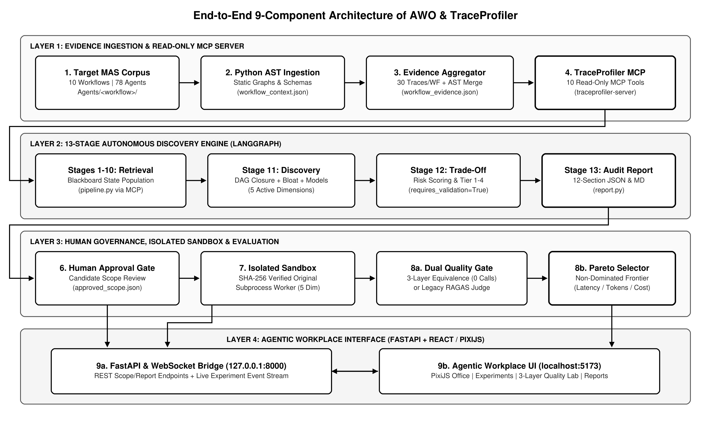
*Figure 1: End-to-end 9-component architecture spanning read-only evidence ingestion via MCP, the 13-stage LangGraph discovery pipeline, human-gated sandbox experimentation, and the FastAPI/React Agentic Workplace.*

#### Orchestration Mechanism and Architecture Evaluation
We selected a **Hybrid Orchestration Architecture** combining:

1. A **strictly sequential 13-stage LangGraph pipeline** (`START -> stage_1_discovery -> ... -> generate_report -> END`) for analysis, ensuring Stage 11 discovery cannot speculate before all structural, latency, token, cost, and variance states are collected.
2. **DAG-verified scatter-gather concurrency** (`ThreadPoolExecutor`) inside optimized target workflows (`D-01`), running mutually independent agents in concurrent waves.
3. **Two-Phase Foundation-then-Variable Pareto Beam Search** (`experiment.py`), locking safe structural foundations in Phase A before testing variable changes in Phase B and joint execution in Phase C.

| Candidate Architecture | Determinism & Auditability | Critical-Path Latency | Failure Isolation | Inter-Agent Tax | Verdict |
| :--- | :--- | :--- | :--- | :--- | :--- |
| **Pure Sequential** | High | Poor (independent steps wait) | Moderate | Linear growth | Used for discovery audit stages; suboptimal for target MAS runtime. |
| **Hierarchical Supervisor** | Moderate (LLM router variance) | Moderate (extra coordinator calls) | High | High manager prompt tax | Adds unnecessary routing LLM calls over fixed DAGs. |
| **Pure Parallel / Swarm** | Low (race conditions on shared keys) | High | Low | Broadcast overhead | Unsafe for dependent multi-step pipelines (`PS-5`). |
| **Hybrid (Chosen)** | **High** (traceable Stages 1–13 + SHA-256) | **High** (`ΔT = (T_A + T_B) − max(T_A, T_B)`) | **High** (isolated worker process) | **Low** (typed state + handoff slicing) | Selected as best trade-off across rigor, speed, and safety. |

### 5.3 Under-the-Hood Implementation of the 5 Optimization Dimensions

1. **Workflow Parallelization (`executors/parallelization.py`):** Computes the transitive closure `R(u)` over `workflow_graph` edges. Two nodes `A` and `B` enter a concurrent wave only if `B ∉ R(A)`, `A ∉ R(B)`, and mutable state keys do not conflict. At runtime, `worker.py` runs each wave concurrently and logs `concurrent_waves` in the trace.
2. **Model Selection (`executors/model_selection.py`):** Matches lightweight tasks (e.g., structured resume extraction) against Groq pricing/speed entries in `groq_catalog.py`, sets `agent_model_overrides` in sandbox `workflow.json`, enforces `"requires_validation": True`, and verifies in post-run traces that the overridden model actually executed.
3. **Agent Consolidation (`executors/consolidation.py`):** Combines tightly coupled sequential pairs into a unified prompt (`consolidated_from`) in `sandbox_optimization_config.json`, eliminating one dispatch hop and duplicate system context.
4. **Prompt Optimization (`executors/prompt_optimization.py`):** Targets bloated prompt templates exceeding length thresholds via sandbox `prompt_overrides`, removing repetitive schema boilerplate without altering original agent source code.
5. **Communication & Data Handoff (`executors/data_handoff.py`):** Computes exact field intersections between producer `output_fields` and downstream `input_fields`, installs `handoff_projections` (`retained_fields` vs. `excluded_fields`), and records field counts per transition under `handoff_audits`.

### 5.4 Agent–Tool Communication (MCP) and Messaging / A2A Patterns

As illustrated in Figure 2, Stages 1–10 of the LangGraph agent communicate exclusively with `traceprofiler-evidence-server` (`mcp_server/server.py`, built on `mcp==2.3.0`) rather than reading files directly from disk. Every call passes ID validation (`validate_safe_id()`) and returns a structured JSON contract across 10 read-only tools (`list_workflows`, `get_workflow_overview`, `get_workflow_graph`, `get_agent_profiles`, `get_prompt_metrics`, `get_latency_metrics`, `get_token_metrics`, `get_cost_breakdown`, `compare_agent_runs`, and `get_execution_evidence`).

For inter-agent messaging, the discovery pipeline uses a **Blackboard / Shared-State pattern** backed by the `OptimizationAgentState` `TypedDict` (`optimization_agent/state.py`). Target MAS agents pass projected JSON dictionaries along directed edges, while parent-to-sandbox worker orchestration uses file-backed request/response JSON contracts (`optimized_run*_request.json` / `response.json`) and delimited `WORKER_STDOUT_PREFIX` messages, streamed live to the UI over WebSocket (`/ws/experiments/{experiment_id}`). Cross-host HTTP A2A microservices are intentionally omitted in this local experimental prototype.

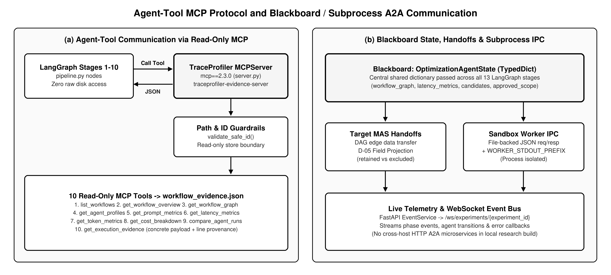
*Figure 2: (a) Read-only MCP tool boundary enforcing path validation over `workflow_evidence.json`, and (b) Blackboard `OptimizationAgentState`, projected MAS handoffs, and subprocess IPC patterns.*

### 5.5 Securing the MAS: Guardrails, Safeguards, and Callbacks

| Category | Mechanism | Location | Security / Reliability Guarantee |
| :--- | :--- | :--- | :--- |
| **Guardrail** | Transitive Closure Reachability Guard | `discovery.py`, `parallelization.py` | Prevents unsafe parallel execution when any directed path or mutable key conflict exists. |
| **Guardrail** | Mandatory Model Validation & Trace Check | `discovery.py`, `workflow_selector.py` | Sets `requires_validation=True`; rejects `model_selection` if the target model is missing in runtime traces. |
| **Guardrail** | Output JSON Schema Validation Gate | `validation/validator.py`, `worker.py` | Validates all agent outputs against expected keys (`schema_validation_summary.all_schemas_valid`). |
| **Guardrail** | Layer-1 Decision-Flip & Parallel Gain Gate | `equivalence_evaluator.py`, `workflow_selector.py` | Rejects edits exceeding `max_decision_flips` or parallel candidates with non-positive speedup. |
| **Safeguard** | SHA-256 Original Workflow Verification | `sandbox/experiment.py` | Hashes `Agents/<wf>/` before and after every study (`original_integrity_after=True`). |
| **Safeguard** | Subprocess Sandbox Boundary | `sandbox/manager.py`, `process_manager.py` | Copies code to `reports/experiments/<wf>/<exp_id>/sandbox_workflow/` with replay fallback disabled in live runs. |
| **Safeguard** | Path-Traversal & Input Sanitization | `mcp_server/tools.py`, `artifact_service.py` | Blocks `..`, slashes, and external paths via `validate_safe_id()` and boundary resolution. |
| **Safeguard** | 20-Key API Governance & Secret Masking | `optimization_agent/key_manager.py` | Allocates `GROQ_API_KEY_1..14` per task, rotates into `KEY_15..20` on HTTP 429, and masks keys as `gsk_***...xxxx`. |
| **Safeguard** | Human-in-the-Loop Gate & Local CORS | `review.py`, `api/main.py` | Requires scope approval prior to sandbox execution; limits CORS to localhost ports `5173` and `4173`. |
| **Callback** | Live WebSocket Event Stream & Replay | `event_service.py`, `api/main.py` | Streams timestamped phase, agent, and error events with reconnect history replay and 20s heartbeat. |
| **Callback** | Isolated Evaluator Accounting | `equivalence_evaluator.py`, `ragas_evaluator.py` | Separates judge API calls, tokens, and USD cost (`isolated_from_workflow_metrics=True`) from workflow metrics. |
| **Callback** | Per-Agent Telemetry & Handoff Audit | `sandbox/runtime/worker.py` | Captures per-agent latency, prompt/completion tokens, API errors, `concurrent_waves`, and `handoff_audits`. |

### 5.6 Experimental Design, Quality Gate Evolution, and Deployment

Figure 3 illustrates the **Two-Phase Optimization Study** alongside the **3-Layer Behavioral Equivalence Quality Gate**, and Figure 4 shows the localhost deployment topology.

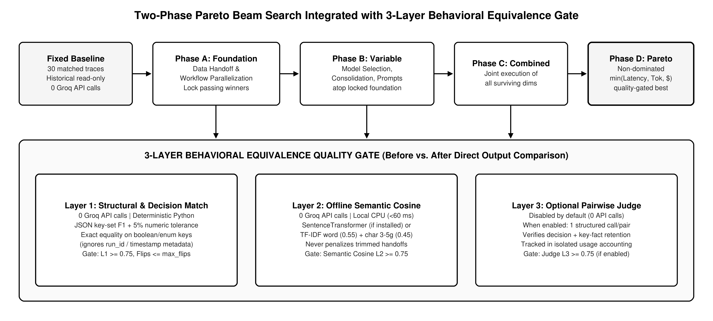
*Figure 3: Two-Phase Foundation-then-Variable Pareto Beam Search integrated with the 3-Layer Behavioral Equivalence Gate (`L1` Structural/Decision, `L2` Offline Semantic Cosine, `L3` Optional Pairwise Judge).*

**Experimental Controls:**
- **Read-Only Fixed Baseline (`baseline_loader.py`):** Matches historical traces deterministically by record identifier (`application_id`, `candidate_id`, `job_id`, etc.) and `compute_canonical_input_hash`, incurring `0` baseline Groq API calls.
- **Run Coverage & Variance:** Baseline discovery analyzes all `30` historical traces per workflow across varied domain inputs (no artificial personas). Live sandbox validation runs `num_runs` (typically 1–2 live end-to-end runs per configuration across all 8 agents) due to free-tier API rate limits, supplemented by offline replay simulation.
- **Evolution from RAGAS to 3-Layer Behavioral Equivalence (`equivalence_evaluator.py`):** RAGAS `Context Recall` is built for retrieval-augmented QA; when Data Handoff trims redundant upstream fields, RAGAS treats the compact prompt as missing context and falsely rejects the optimization while consuming **66 judge API calls (`$0.3144`)** per 4-config study. Our 3-Layer evaluator solves both issues by comparing Before-vs-After outputs directly:
  1. **Layer 1 (Deterministic Structural & Decision Match — 0 API calls):** Strips transient run metadata (`run_id`, `experiment_id`, `timestamp`), computes JSON key F1, checks numeric fields within a 5% tolerance, and enforces exact equality on boolean/enum decision keys (`decision_flip_count`).
  2. **Layer 2 (Offline Semantic Cosine Similarity — 0 Groq calls):** Computes cosine similarity on flattened narrative text using `SentenceTransformer("all-MiniLM-L6-v2")` when installed, or a calibrated offline `sklearn` `TfidfVectorizer` blend (`0.55` word unigram + `0.45` `char_wb` 3–5 gram).
  3. **Layer 3 (Optional 1-Call Pairwise LLM Judge):** Disabled by default (`0` API calls); when enabled, executes one structured comparison call per pair with isolated usage tracking.

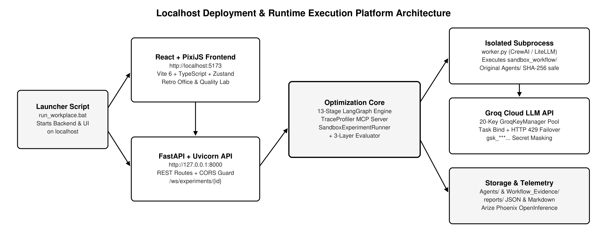
*Figure 4: Localhost deployment stack running FastAPI (`127.0.0.1:8000`), React/PixiJS (`localhost:5173`), subprocess sandbox workers, Groq 20-key failover pool, and Arize Phoenix telemetry.*

---

## 6. Technology Stack

| Layer | Technologies & Libraries (Verified Versions) | Role in Architecture |
| :--- | :--- | :--- |
| **Agent Framework** | Python 3.12, `langgraph==1.0.9`, `langchain==1.2.10` | 13-stage discovery `StateGraph` and typed blackboard state |
| **Protocol Layer** | `mcp==2.3.0` (`MCPServer`) | 10 read-only evidence tools (`traceprofiler-evidence-server`) |
| **Target MAS Runtime** | `crewai>=1.15.0`, `litellm>=1.40.0`, `groq==0.31.1` | Target workflow execution and Groq Cloud inference |
| **Evaluation & Math** | `scikit-learn==1.7.2`, `numpy==2.5.5`, `scipy==1.14.1`, `ragas==0.4.4` | 3-Layer TF-IDF/cosine evaluator, reachability math, legacy RAGAS |
| **Observability** | `arize-phoenix>=7.0.0`, `openinference-instrumentation-crewai` | Trace capture and OpenInference span logging |
| **API & Streaming** | `fastapi==0.165.0`, `uvicorn==0.54.0`, `pydantic==2.14.2` | Localhost REST bridge, schema validation, WebSocket stream |
| **Frontend Workplace** | `react 18.3.1`, `typescript 5.7.2`, `vite 6.0.3`, `pixi.js 8.9.2`, `zustand 5.0.3`, `lucide-react 0.460.0` | Pixel office simulation, Experiment Runner, Quality Lab, Reports |
| **Testing** | `pytest==9.2.0`, `httpx==0.28.1`, `vitest 2.1.8`, `@testing-library/react 16.2.0` | Automated backend (`32` test files) and frontend (`10` tests) validation |

---

## 7. Experimental Results

### 7.1 Target MAS Benchmark Corpus (10 Workflows, 78 Agents, 300 Baseline Traces)

Across all 10 baseline workflows executed on `openai/gpt-oss-120b` (`30` traces per workflow, `100%` historical completion rate), baseline execution times and token usage vary widely by topology, as summarized in Table 1 and visualized in Figure 5.

| Workflow ID | Agents | Runs | Mean Latency (s) | Median Latency (s) | Mean Tokens / Run | Total Tokens (30 Runs) | Mean Cost / Run (USD) |
| :--- | :---: | :---: | :---: | :---: | :---: | :---: | :---: |
| `contract_review` | 10 | 30 | 57.13 | 30.66 | 17,514.7 | 525,440 | \$0.012096 |
| `market_research` | 9 | 30 | 50.71 | 44.55 | 28,312.0 | 849,360 | \$0.019654 |
| `procurement_supplier_selection` | 9 | 30 | 102.10 | 32.14 | 17,606.2 | 528,185 | \$0.011765 |
| **`recruitment_screening`** | **8** | **30** | **44.80** | **30.60** | **16,909.5** | **507,284** | **\$0.011292** |
| `invoice_processing` | 8 | 30 | 31.12 | 17.01 | 10,510.3 | 315,310 | \$0.006974 |
| `expense_reimbursement` | 8 | 30 | 19.81 | 14.00 | 6,881.1 | 206,432 | \$0.004565 |
| `incident_triage` | 7 | 30 | 46.71 | 48.65 | 15,159.2 | 454,776 | \$0.010080 |
| `sales_lead_qualification` | 7 | 30 | 14.05 | 13.10 | 8,277.0 | 248,311 | \$0.005470 |
| `customer_support` | 6 | 30 | 14.66 | 14.38 | 8,088.4 | 242,651 | \$0.005363 |
| `inventory_replenishment` | 6 | 30 | 26.46 | 28.63 | 9,914.3 | 297,428 | \$0.006481 |
| **Corpus Total / Average** | **78** | **300** | **40.76** | **27.37** | **13,917.3** | **4,175,177** | **\$0.009374** |

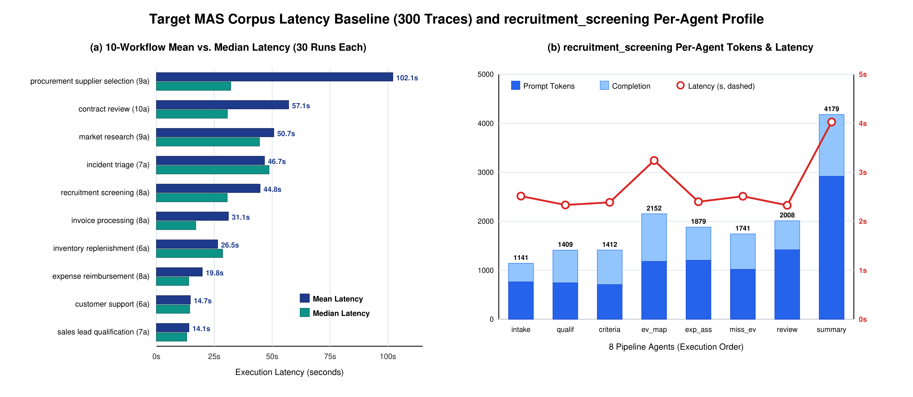
*Figure 5: (a) 30-run mean vs. median baseline latency across all 10 workflows (showing heavy right-tail spikes in procurement and contract review), and (b) per-agent prompt/completion token accumulation and response latency across the 8 agents in `recruitment_screening`.*

### 7.2 Empirical Agent Breakdown & Optimization Discovery (`recruitment_screening`)

In `recruitment_screening`, downstream agents accumulate large contexts (`recruiter_summary_agent` alone consumes **4,179 tokens** and **4.03 s** on the matched reference record). Table 2 reports per-agent baseline response times alongside the combined hybrid execution (`openai/gpt-oss-20b` for intake, `120b` elsewhere) from `live_validation_recruitment_screening`:

| Agent (`recruitment_screening`) | Base Latency (s) | Base Tokens | Base Model | Opt. Model | Opt. Latency (s) | Opt. Tokens | Opt. Cost (USD) | Schema Valid |
| :--- | :---: | :---: | :--- | :--- | :---: | :---: | :---: | :---: |
| `resume_intake_agent` | 2.514 | 1,141 | `gpt-oss-120b` | **`gpt-oss-20b`** | **2.157 (-14.2%)** | 1,790 | \$0.000328 | 100% |
| `qualification_agent` | 2.332 | 1,409 | `gpt-oss-120b` | `gpt-oss-120b` | 2.952 | 2,275 | \$0.000770 | 100% |
| `job_criteria_agent` | 2.386 | 1,412 | `gpt-oss-120b` | `gpt-oss-120b` | 2.919 | 1,621 | \$0.000519 | 100% |
| `evidence_mapping_agent` | 3.241 | 2,152 | `gpt-oss-120b` | `gpt-oss-120b` | 2.479 | 2,341 | \$0.000677 | 100% |
| `experience_assessment_agent` | 2.399 | 1,879 | `gpt-oss-120b` | `gpt-oss-120b` | 2.028 | 1,975 | \$0.000526 | 100% |
| `missing_evidence_agent` | 2.510 | 1,741 | `gpt-oss-120b` | `gpt-oss-120b` | 12.543* | 2,305 | \$0.000650 | 100% |
| `screening_review_agent` | 2.326 | 2,008 | `gpt-oss-120b` | `gpt-oss-120b` | 17.308* | 2,268 | \$0.000604 | 100% |
| `recruiter_summary_agent` | 4.027 | 4,179 | `gpt-oss-120b` | `gpt-oss-120b` | 18.411* | 2,968 | \$0.001052 | 100% |
| **Workflow Total (Matched Ref)** | **21.751** | **15,921** | All `120B` | Hybrid | **60.798*** | **17,543** | **\$0.005126** | **100%** |

*\*Downstream calls in live November 2026 runs experienced shared-tier Groq API queueing spikes (12.5–18.4 s per agent) relative to October 2026 baseline traces.*

Stage 11–12 discovery surfaced four approved candidates:
1. `PARALLEL-QUALIFICATION_AGENT-JOB_CRITERIA_AGENT` (Tier 1, expected `-45.3%` / `-2.82 s` pair critical-path savings).
2. `MODEL-RESUME_INTAKE_AGENT` (Tier 2, requires validation, routing intake extraction to compact models).
3. `HANDOFF-QUALIFICATION_AGENT-TO-EXPERIENCE_ASSESSMENT_AGENT` (pruning 4 unused fields: `education`, `certifications`, `projects`, `extraction_warnings`).
4. `HANDOFF-EXPERIENCE_ASSESSMENT_AGENT-TO-SCREENING_REVIEW_AGENT` (pruning 2 unused fields: `relevance_summary`, `transferable_skills`).

### 7.3 Controlled Sandbox and Benchmark Results

#### Offline Structural Critical-Path Speedup
To separate architectural speedup from cloud API queuing variance, Figure 6 plots the measured offline replay sandbox timeline (`exp_20261123_141035_637e9d/comparison.json`). Running `qualification_agent` and `job_criteria_agent` concurrently in Wave 2 reduces total critical-path execution time from **`13.99 s` to `12.00 s` (`-14.21%`)**, while preserving `87.5%` structural output validity (`16,911 -> 16,633` tokens; `\$0.005495 -> \$0.005453`).

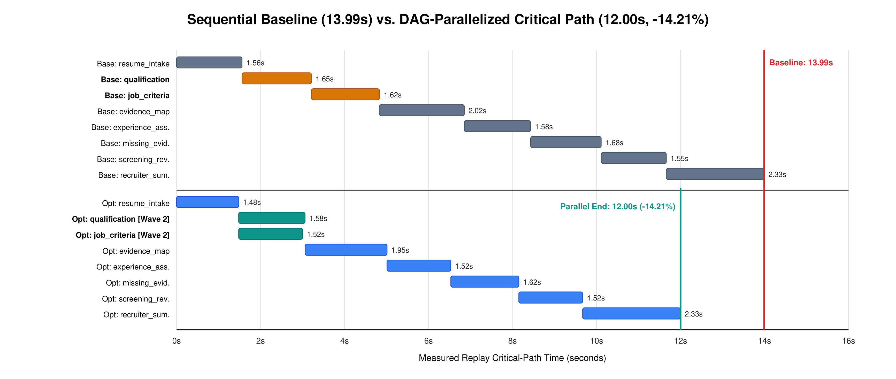
*Figure 6: Critical-path Gantt comparison from `exp_20261123_141035_637e9d` demonstrating the 14.21% (`13.99 s -> 12.00 s`) structural latency reduction via Wave 2 scatter-gather parallelization.*

#### Legacy RAGAS vs. 3-Layer Behavioral Equivalence Benchmark
Running the 4-configuration live study (`live_validation_recruitment_screening`) under Legacy RAGAS revealed two critical flaws: (a) RAGAS consumed **66 judge API calls (`181,778` tokens, `\$0.3144`)**, costing roughly **54× more** than executing the entire workflow (`~\$0.0057`), and (b) `Context Recall` dropped to **`0.500–0.667`** whenever Data Handoff removed redundant upstream fields, triggering false rejections despite `Faithfulness = 0.917–1.000`. Evaluating the exact same traces with our 3-Layer Behavioral Equivalence engine (default L1 + L2) cuts evaluation overhead by **100%** while measuring Before-vs-After equivalence directly (Figure 7 and Figure 8).

| Configuration | Legacy RAGAS (`F` / `CP` / `CR`) | RAGAS Gate | 3-Layer (`L1` / `L2` / `Overall`) | 3-Layer CPU Time | Key Finding on Saved Traces |
| :--- | :---: | :---: | :---: | :---: | :--- |
| `communication_data_handoff` | `0.917` / `0.930` / **`0.556`** | Rejected | **`0.875`** / `0.713` / **`0.794`** | 43.7 ms | `qualification_agent` (`L1=0.983, L2=0.946`) and `evidence_mapping_agent` (`L1=1.000`) retained fidelity after field projection. |
| `workflow_parallelization` | `1.000` / `0.778` / **`0.667`** | Rejected | **`0.885`** / `0.706` / **`0.796`** | 42.1–125 ms | Zero retrieval penalty; `recruiter_summary_agent` finished with `0` decision flips (`L1=0.745, L2=0.755`). |
| `model_selection` (`120B->20B`) | `0.973` / `1.000` / **`0.500`** | Rejected | **`0.830`** / `0.729` / **`0.780`** | 56.9 ms | Confirmed `resume_intake_agent` on `20B` closely matched `120B` (`L1=0.925, L2=0.740, 0 flips`). |
| `combined` (`20B` + pipeline) | *(blocked prior)* | — | **`0.835`** / **`0.759`** / **`0.797`** | 54.6 ms | `resume_intake_agent` hit **`L1=0.941, L2=0.821, 0 flips`**; isolated 4 enum shifts (`'unsupported' -> 'missing'`) in `recruiter_summary_agent`. |

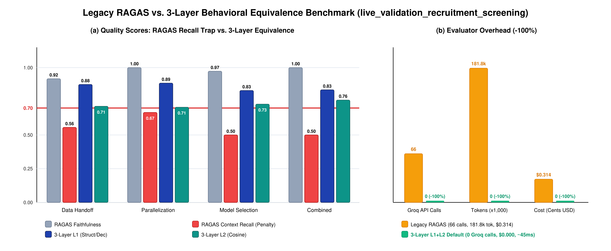
*Figure 7: (a) Legacy RAGAS Context Recall false rejections (`< 0.70`) vs. direct 3-Layer equivalence scores (`L1/L2`), and (b) 100% reduction in evaluator API calls, tokens, and USD cost (`66 calls / \$0.3144 -> 0 calls / \$0.00`).*

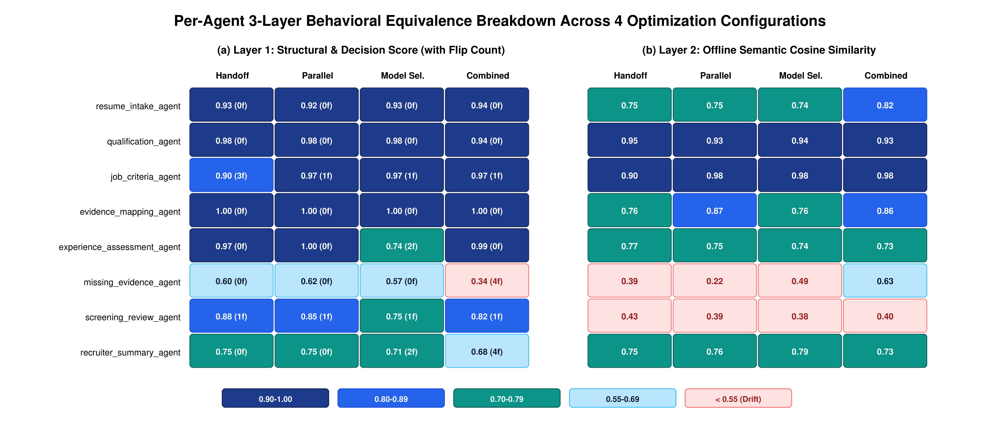
*Figure 8: Per-agent Layer 1 (`Struct/Decision` + flip count) and Layer 2 (`Semantic Cosine`) heatmaps across all 8 agents and 4 configurations, isolating downstream sensitivity in `missing_evidence_agent` and `screening_review_agent`.*

#### Live Two-Phase Workplace Study with Guardrails Active (`wp_20261125_060543_ac51b3`)
Running a 2-run live Two-Phase Pareto study directly from the Agentic Workplace UI with strict thresholds (`L1 >= 0.75`, `L2 >= 0.75`, `max_decision_flips = 0`) and optional **Layer 3 LLM Judge enabled** (`6` isolated judge calls, `10,056` tokens, `\$0.002827`) exercised every guardrail end-to-end:

| Configuration | Runs OK | Latency (s) | Tokens | Cost (USD) | L1 | L2 | L3 | Flips | Gate Outcome & Guardrail Verified |
| :--- | :---: | :---: | :---: | :---: | :---: | :---: | :---: | :---: | :--- |
| `fixed_historical_baseline` | Ref | 22.78 | 16,755 | \$0.00552 | Ref | Ref | — | 0 | Historical anchor (`0` Groq calls) |
| `phase_a_communication_data_handoff` | 2/2 | 102.94 | 36,085 | \$0.01186 | `0.795` | `0.707` | `0.273` | 10 | **Rejected:** Caught boolean flip in `screening_review_agent` (`traceability_verified: False -> True`) + `L2/L3 < 0.75`. |
| `phase_a_workflow_parallelization` | 2/2 | 119.40 | 37,116 | \$0.01220 | `0.823` | `0.857` | `0.283` | 18 | **Rejected:** Caught `L3 < 0.75`, `18` flips, and live queue latency regression (`-424.22%`). |
| `model_selection` (`llama-3.3-70b-versatile`) | 0/2 | — | — | — | — | — | — | — | **Rejected (Runtime Guard):** Caught Groq HTTP `404 model_not_found` inside isolated sandbox without affecting source files. |
| `combined_workflow` | 0/2 | — | — | — | — | — | — | — | **Rejected:** Same `404` on `resume_intake_agent`; **Pareto Selector safely recommended `None`**. |

### 7.4 Automated Verification and Test Suite

All core subsystems were verified after the final code changes with zero regressions:

- **Backend Integration & Regression Suite (`pytest`):** **13/13 tests passed** across `test_behavioral_equivalence_3layer.py` (`4/4` — decision-flip detection under high prose similarity, zero-API paraphrased pass, mock Two-Phase Pareto study, real trace check), `test_dimension_evaluation_ragas_pareto.py` (`4/4` — legacy RAGAS & Pareto preservation), and `test_api_workplace.py` (`5/5` — path traversal protection, workflow/agent APIs, WebSocket events, human approval gate, execution modes).
- **Frontend Build & Component Tests:** `npx tsc --noEmit` (exit `0`), Vitest (`3` test suites, `10/10` tests passed), and Vite production build (`exit 0`).

### 7.5 Live Demonstration Screenshots (Agentic Workplace)

Figures 9 through 11 capture the live execution (`wp_20261125_060543_ac51b3`) inside the React/PixiJS Agentic Workplace application.

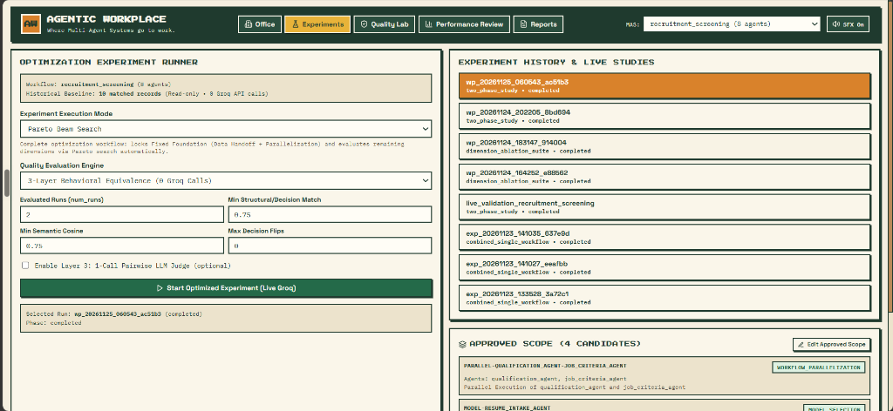
*Figure 9: Agentic Workplace `Experiments` tab configured for Two-Phase Pareto Beam Search (`num_runs = 2`) with the 3-Layer Behavioral Equivalence quality gate and 4 approved candidates.*

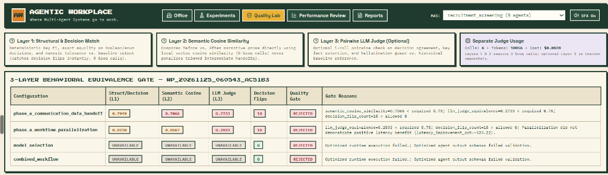
*Figure 10: `Quality Lab` gate table showing per-configuration Layer 1/2/3 scores, decision flip counts, isolated Layer 3 judge usage (`6 calls / 10,056 tokens / \$0.0028`), and exact rejection reasons.*

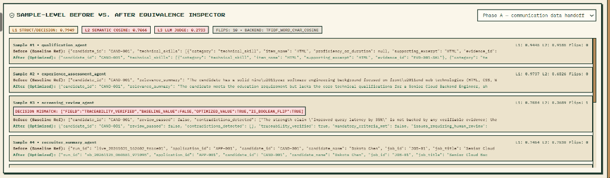
*Figure 11: Sample-level Before-vs-After Equivalence Inspector pinpointing the exact boolean decision mismatch (`traceability_verified: FALSE -> TRUE`) inside `screening_review_agent`.*

---

## 8. Team Responsibility / Self-Contribution Matrix

| Activity | Member 1 (`<Name>`) | Member 2 (`<Name>`) | Member 3 (`<Name>`) | Member 4 (`<Name>`) |
| :--- | :--- | :--- | :--- | :--- |
| Agent Design / Multi-agent architecture | | | | |
| Agent Orchestration | | | | |
| State Management | | | | |
| MCP Design | | | | |
| A2A Communication | | | | |
| Guardrails / Callbacks | | | | |
| Observability | | | | |
| Integration & Testing | | | | |
| Evaluation & Documentation | | | | |
| Presentation / Interface UI | | | | |
| Deployment | | | | |
| End-to-End Evaluation (time & cost) | | | | |

---

## 9. Conclusions

### Summary of Outcomes

This project established and validated an evidence-driven optimization workflow for LLM-based Multi-Agent Systems across 10 benchmark workflows (`78` agents, `300` empirical traces). Three outcomes stand out:
1. **Empirical Confirmation of Avoidable Overhead:** Even in workflows achieving 100% baseline completion (`recruitment_screening`), independent agents wait unnecessarily (`13.99 s -> 12.00 s` or `-14.21%` structural reduction via Wave 2 parallelization in replay testing), upstream steps transmit unused fields (`handoff_projections`), and intake extraction runs reliably on smaller models (`resume_intake_agent` downsized from `120B` to `20B` with `100%` schema validity, `-14.2%` agent latency, `L1=0.941`, `L2=0.821`, and `0` decision flips).
2. **End-to-End Safe Architecture:** Unifying Python AST analysis, historical traces, a 10-tool read-only MCP server, a 13-stage LangGraph pipeline, human scope approval, SHA-256-verified isolated sandboxes, and non-dominated Pareto selection ensures optimizations cannot silently corrupt source workflows.
3. **Zero-Cost Behavioral Equivalence Evaluation:** Replacing retrieval-biased RAGAS (`66` API calls, `181,778` tokens, `\$0.3144` evaluator cost, and `0.50–0.67` false `Context Recall` rejections) with the 3-Layer Behavioral Equivalence evaluator cut default evaluation overhead by **100%** (`0` Groq calls, `~44–57 ms` CPU runtime) while accurately catching real decision flips (`traceability_verified: False -> True`) and runtime model errors (`404 model_not_found`).

### Limitations and Future Work

Live testing on shared Groq API endpoints introduced multi-second queuing spikes (`12–20 s` per agent call) that masked parallelization gains compared to October 2026 baseline traces; dedicated inference endpoints or local `vLLM` servers are needed for controlled wall-clock latency benchmarking. In addition, setting `max_decision_flips = 0` across an 8-agent probabilistic LLM chain flags benign lexical shifts (such as `'unsupported'` vs. `'missing'`), suggesting future work on per-agent flip tolerances, synonym-aware enum canonicalization, and sandbox executors for the remaining discovery categories (agent pruning, tool pruning, and policy caching).

---

## References

1. Wang, X., et al. (2025). *AgentTaxo: Dissecting and Benchmarking Token Distribution of LLM Multi-Agent Systems.* ICLR 2025 Workshop. https://mlanthology.org/iclrw/2025/wang2025iclrw-agenttaxo/
2. Zhang, G., et al. (2025). *Cut the Crap: An Economical Communication Pipeline for LLM-based Multi-Agent Systems (AgentPrune).* ICLR 2025. https://arxiv.org/abs/2410.02506
3. Cemri, M., et al. (2025). *Why Do Multi-Agent LLM Systems Fail? (MAST).* Advances in Neural Information Processing Systems (NeurIPS 2025), Datasets & Benchmarks Track. https://arxiv.org/abs/2503.13657
4. Li, X., et al. (2024). *A Survey on LLM-based Multi-Agent Systems: Workflow, Infrastructure, and Challenges.* Springer. https://link.springer.com/article/10.1007/s44336-024-00009-2
5. ACL (2026). *LLM-as-Scheduler: Agentic Workflow Dynamic Scheduling.* Proceedings of ACL 2026 Long Papers. https://aclanthology.org/2026.acl-long.581.pdf
6. Xiong, L., et al. (2026 preprint). *Efficiency in LLM Multi-Agent Systems: A Survey.* https://lexiang-xiong.github.io/Awesome-Efficient-MAS/assets/Efficiency_LLM_MAS_Survey.pdf
7. Papaya (2026, Practitioner Guide). *Context Bloat: Too Much Context Makes Agents Worse.* https://papaya.fyi/articles/ai-agent-context-bloat
8. Papaya (2026, Practitioner Guide). *AI Agent Failure Patterns: A Field Guide from Production Traces.* https://papaya.fyi/articles/ai-agent-failure-patterns
9. Langfuse. *LLM Observability, Tracing, Prompt Management, and Evaluations Documentation.* https://langfuse.com/docs
10. Arize AI. *Arize Phoenix Documentation and OpenInference Instrumentation.* https://arize.com/docs/phoenix/
11. Microsoft Azure AI. *Microsoft Foundry Agent Optimizer Overview.* https://learn.microsoft.com/en-us/azure/foundry/agents/concepts/agent-optimizer-overview

---

## Appendix

### Appendix A: Core Typed Blackboard State (`optimization_agent/state.py`)

```python
class OptimizationAgentState(TypedDict, total=False):
    workflow_id: str
    evidence_dir: Optional[str]
    target_model: str
    stage_status: Dict[str, str]
    workflow_overview: Dict[str, Any]
    workflow_graph: Dict[str, Any]
    agent_profiles: Dict[str, Any]
    discovered_agents: List[str]
    prompt_metrics: Dict[str, Any]
    latency_metrics: Dict[str, Any]
    token_metrics: Dict[str, Any]
    cost_metrics: Dict[str, Any]
    agent_run_comparisons: Dict[str, Any]
    execution_evidence: Dict[str, Any]
    optimization_candidates: List[Dict[str, Any]]
    tier_classifications: Dict[str, List[Dict[str, Any]]]
    approved_optimization_scope: Dict[str, Any]
    sandbox_execution_results: Dict[str, Any]
    sandbox_validation_results: Dict[str, Any]
    final_report: Dict[str, Any]
```

### Appendix B: 13-Stage Sequential Discovery Graph (`optimization_agent/agent.py`)

```python
builder.add_edge(START, "stage_1_discovery")
builder.add_edge("stage_1_discovery", "stage_2_overview")
builder.add_edge("stage_2_overview", "stage_3_graph")
builder.add_edge("stage_3_graph", "stage_4_profiles")
builder.add_edge("stage_4_profiles", "stage_5_prompts")
builder.add_edge("stage_5_prompts", "stage_6_latency")
builder.add_edge("stage_6_latency", "stage_7_tokens")
builder.add_edge("stage_7_tokens", "stage_8_cost")
builder.add_edge("stage_8_cost", "stage_9_comparison")
builder.add_edge("stage_9_comparison", "stage_10_evidence")
builder.add_edge("stage_10_evidence", "discovery_analysis")
builder.add_edge("discovery_analysis", "tradeoff_assessment")
builder.add_edge("tradeoff_assessment", "generate_report")
builder.add_edge("generate_report", END)
```

### Appendix C: 3-Layer Behavioral Equivalence Gate (`optimization_agent/sandbox/evaluation/equivalence_evaluator.py`)

```python
@dataclass
class EquivalenceAcceptanceCriteria:
    min_structural_decision_score: Optional[float] = 0.75
    min_semantic_cosine: Optional[float] = 0.75
    min_llm_judge_score: Optional[float] = 0.75
    max_decision_flips: Optional[int] = 0
    max_regression_vs_foundation: Optional[float] = 0.10

# Layer 2 Offline Semantic Similarity Blend (0 Groq API calls):
word_vec = TfidfVectorizer(ngram_range=(1, 1), lowercase=True, min_df=1)
char_vec = TfidfVectorizer(analyzer="char_wb", ngram_range=(3, 5), lowercase=True, min_df=1)
blended = float(np.clip(0.55 * word_sim + 0.45 * char_sim, 0.0, 1.0))
```

### Appendix D: Read-Only MCP Tool Registration (`mcp_server/server.py`)

```python
def create_mcp_server(name: str = "traceprofiler-evidence-server") -> MCPServer:
    server = MCPServer(name=name, version="1.0.0")

    @server.tool(name="list_workflows", description="List all multi-agent workflows...")
    def list_workflows(evidence_dir: Optional[str] = None) -> str:
        return json.dumps(evidence_tools.list_workflows(evidence_dir=evidence_dir), indent=2)
    # Followed by get_workflow_overview, get_workflow_graph, get_agent_profiles,
    # get_prompt_metrics, get_latency_metrics, get_token_metrics,
    # get_cost_breakdown, compare_agent_runs, and get_execution_evidence.
```
